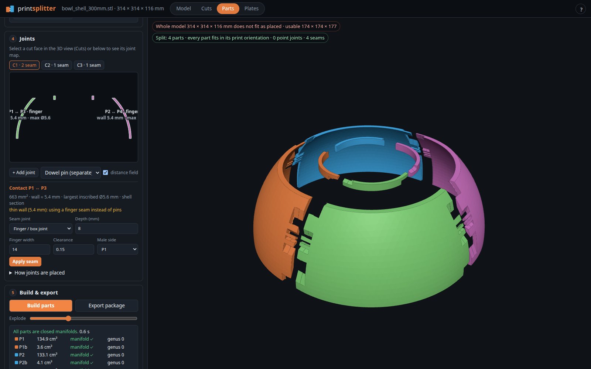
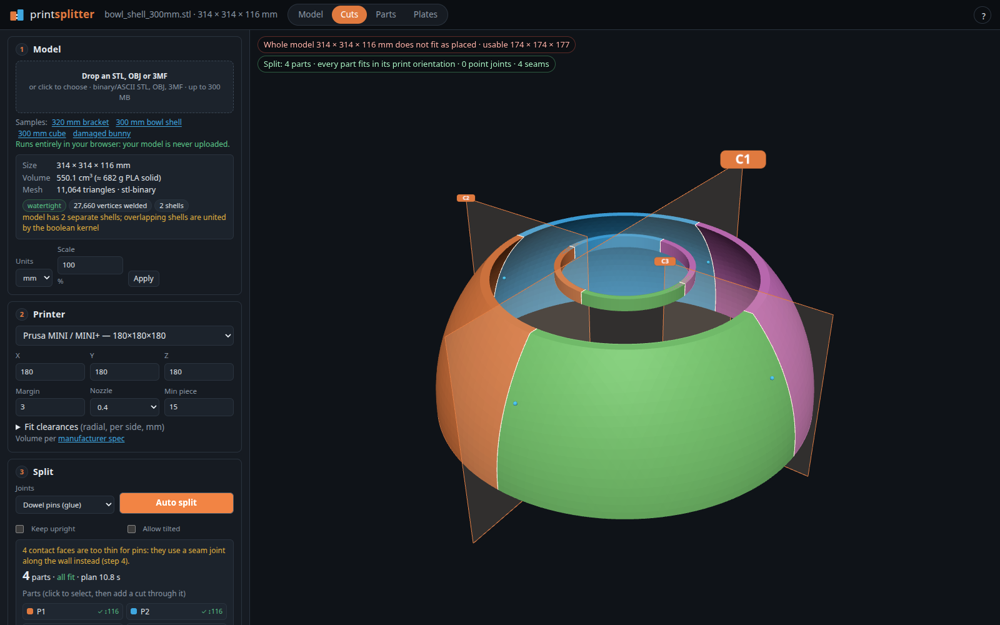

# splitter

**Split a 3D model that is too big for your printer into parts that fit, with joints on every cut face, and export print-ready plates and an assembly sheet.**

**Live:** <https://magnusp.is/splitter/>. It runs entirely in your browser. Your model is never uploaded.



## What it does

1. **Load** an STL (binary or ASCII), OBJ or 3MF up to 300 MB. The mesh is welded and repaired: holes are capped, flipped and inside-out faces are fixed, duplicate and degenerate faces are removed, non-manifold edges are split and debris is dropped. Each repair is counted in the UI. Meshes above 600k triangles are simplified for planning (closed shells kept, measured deviation shown) and parts are cut from the full-detail original; see [Large meshes](docs/large-meshes.md).
2. **Choose a printer** (Prusa, Bambu Lab, Creality, Voron presets, or a custom volume) and a safety margin.
3. **Plan cuts.** A BSP search over cut planes trades part count against estimated support demand. The **Fewer parts ↔ Less support** slider defaults to Balanced; move it fully left for the legacy parts-first objective. You can move, tilt, delete or add cuts. **Auto-complete** then splits only the parts that still do not fit.
4. **Joints.** Every cut face is analysed, and joints are placed where the wall can hold them. You can edit them on a 2D joint map, which opens as a large zoomable editor (wheel/pinch, keyboard, phone layout) with the 3D view optionally beside it.
5. **Build** every part as a closed manifold solid with the [Manifold](https://github.com/elalish/manifold) kernel. The interference between mating parts is checked.
6. **Export** a zip: oriented STLs, one 3MF per print plate, an all-plates 3MF, an assembled preview, an HTML assembly sheet, `plan.json` and a per-part report.



## Profiles

In Fit, use **Profiles… → Save as…** to name your printer and material settings. A profile stores the printer or custom volume, nozzle, margin, minimum piece size, joint style and all five fit clearances. It does not store a model, cuts, scale, orientation or support preference.

Selecting a profile applies its saved values. Edits show **Modified · Save to keep**; **Save** updates the profile. Last-used settings still return after a reload, including unsaved edits. **Rename** changes the name; **Delete** asks for confirmation and leaves the current settings in place. Reset defaults does not delete profiles.

After printing the joint coupon, choose **Enter measured fits**, fill in the clearances, then **Save fits to profile** (or save a new profile). A saved profile is not a physical fit guarantee.

Profiles stay in this browser, on this site: no account, server or upload. **Export** downloads the current or all saved profiles as `splitter-profiles.json`; keep a copy before clearing browser data or moving devices. **Import** adds profiles without overwriting existing ones and reports adjusted values. Invalid files, negative/non-finite numbers and unknown joint styles are rejected; bounded values are normalised to the planner defaults and supported input ranges. Unknown printer ids keep their volume as a custom printer. The app ships with no saved profiles.

## Joint placement

- Each cut face is rasterised and split into **contact patches**, one for each pair of parts that touch there.
- A Euclidean distance transform of each patch gives the largest inscribed circle at every point. Its ridge is the medial axis, and the typical ridge value gives the wall thickness.
- A point joint may sit only where the distance is at least joint radius + clearance + minimum wall. The minimum wall is 2 × nozzle × 1.05 and never below 1.2 mm. This stops a joint from breaking through a visible surface.
- **Depth** comes from ray casts into both parts from the centre and 8 rim points. Pins get shorter (down to 4 mm per side), or move elsewhere.
- Joints are spread by farthest-point sampling: at least 2 per patch so parts cannot rotate, and 3–4 on large faces.
- **The chosen joint style takes priority.** The chosen point joint is placed wherever at least two fit, even on thin shells (in thicker spots such as rims). If only one fits, you get that one plus a warning, because a single pin lets the parts rotate; one click switches that contact to a seam or a keyed peg.
- **Substitutions are shown.** Only when the chosen style cannot be placed at all does a contact get a seam picked by wall thickness: tongue and groove if the wall is ≥ 3 × the minimum wall, half lap if ≥ 2 ×, else finger joint (dovetails only when you choose them). Each one shows a badge such as "Dowels → lap seam: wall 2.3 mm" in the plan summary and on the joint map, with the exact reason and a "Force dowels" action that retries with 2-perimeter walls and 2 mm minimum hole depth (and says so if it still cannot work).
- Changing the **Joints** selector re-places the automatic joints on the current cuts at once; cuts and manual joints are kept. The last settings are restored from browser storage (the page says so); **Reset defaults** goes back to Dowel pins (glue).
- Integrated pegs and seams go on the part that does **not** print on that face, so the face stays flat on the bed. Horizontal holes get teardrop roofs, and horizontal pegs get a flat underside.

| | Glued | Unglued |
|---|---|---|
| **Point joints** | dowel pin (printed separately; glue groove; vented flat) · Ø1.75 mm filament pin · integrated peg · keyed hex/D peg | press-fit pin · magnet pockets (Ø5/6/8/10 × 2–3 mm) · heat-set insert + screw (M2.5–M5) · bolt + hex nut trap · cantilever snap clip |
| **Seam joints** | finger/box joint · tongue & groove · half lap | sliding dovetail |

Clearances are radial, per side, and editable. The defaults for a 0.4 mm nozzle are: press 0.05, glue 0.15, slip 0.20, snap 0.25, seam 0.15 mm. A 0.6 mm nozzle adds 0.05 mm.

## Limits and caveats

- **Physical fit is untested until you print the coupon.** The clearances are geometric. Your printer, filament and slicer decide the real fit. Step 5 generates a **joint test coupon** with six graded clearances. Print it first, then enter the loosest step that still holds.
- **Support is a geometric proxy, not slicer material or print time.** It ignores bridging, support density, supports resting on the model, tree supports, and joint geometry. The coarse raster can miss small features. "Allow tilted" can save parts but usually adds support. Always inspect the exported orientation and supports in your slicer.
- No STEP import. The 3MF files contain geometry only, with no slicer profiles.
- Very large meshes (millions of triangles) are slow in the browser and use a lot of memory.
- Cut planning is a heuristic search. It does not guarantee the global optimum, and on strongly curved shells it may need a manual cut.

## Support-aware cost

Each signed print orientation is scored using a 40 × 40 raster over the part's projected footprint. Only downward-facing surfaces steeper than 45° count. A covered pixel contributes its height above the bed, multiplied by its estimated **surface** area (projected pixel area divided by the normal's cosine). Overlapping columns take the maximum rather than being counted twice. Bed contact within 0.6 mm is ignored. Original triangles are clipped to the BSP cell; cut caps retain their holes.

This produces `supportVolume` in **mm³ of geometric proxy**, shown as cm³ in the UI. It is deliberately not named support grams. The cost added to both cut selection and print orientation is:

```
supportCost = supportVolume_mm3 × 0.004 × supportWeight²
partCost = 100 per estimated part (plus the existing seam/geometry penalties)
```

`supportWeight` is 0–1, defaults to 0.5 when omitted, and is clamped at the API boundary. At Balanced, saving about 100 cm³ of proxy pays for one extra part before seam penalties; at the far right, about 25 cm³. Part cost never becomes zero. At zero, support does not affect the old cut/orientation objective, but the estimate is still reported.

The planner makes required fit cuts first. On a fresh **Plan cuts**, it then considers extra cuts even when a piece already fits, accepting them only when their predicted savings exceed the added part/seam cost and both children fit. It considers at most five offset bands per cut normal (up to 30 shortlisted cuts per search), not every possible split. This is a bounded greedy search, **not** a global optimum. Exact fit checks remain mandatory; support preferences never override Keep upright or the part limit. Auto-complete and manual cut edits do not add support-only cuts.

Changing the slider does not silently replace manual cuts: press Plan cuts to apply it. The UI retains the preference (including zero), shows a pending-change notice, and compares successive auto plans when other settings are unchanged. Reset defaults restores Balanced.

```sh
bin/splitter plan -support-weight 0.5 model.stl > plan.json
# Real browser planning, builds, oriented export, screenshots, persistence:
node e2e/support.mjs http://localhost:8000/ model.stl support-out
```

## How it works

```
model file ─► Go (WebAssembly, Web Worker): parse, weld, repair ─► plan cuts ─► analyse cut faces, place joints, orient parts
                                                                          │ plan JSON
            Manifold (WebAssembly, second Web Worker): build every part ◄─┘
                                                                          │ part meshes
            Go (WebAssembly): orient + pack plates, write STL / 3MF / assembly sheet / zip ◄─┘
```

The planner is plain Go with no third-party modules. It is compiled with the standard toolchain (`GOOS=js GOARCH=wasm`). The same code also runs as a normal HTTP server (`splitter serve`) if you prefer to self-host the processing.

## Build and run

Requires Go 1.27 or newer (see `go.mod`).

```sh
# static, fully client-side site → ./site (serve it from any static host, sub-paths work)
scripts/build-static.sh site
python3 -m http.server -d site 8000        # http://localhost:8000/

# or: server mode (same UI, processing on the server)
go build -o bin/splitter ./cmd/print-splitter
bin/splitter serve -addr 127.0.0.1:8097    # http://127.0.0.1:8097/

# CLI planning only
bin/splitter plan -printer prusa-mini -style glued model.stl > plan.json
```

The static site serves `.wasm` files. Most hosts send them as `application/wasm`, and the loader falls back if they do not.

Tests: `go test ./...`. Browser smoke test (Playwright): `node e2e/smoke.mjs http://localhost:8000/ bracket_320mm.stl prusa-mini`.

Sample models in `web/samples/`:
- the bracket and bowl are generated by `tools/make_samples.mjs`;
- the cube is generated;
- `bunny_damaged.stl` is the Stanford Bunny scaled to 260 mm with holes, flipped, duplicate and degenerate faces added, to exercise mesh repair.

## Licence

MIT, see [LICENSE](LICENSE). Third-party components (Manifold, three.js, Go's `wasm_exec.js`, Stanford Bunny) are listed in [THIRD_PARTY_NOTICES.md](THIRD_PARTY_NOTICES.md).
