# Splitter design pass

This pass works on the merged app (`ux/merge`) and covers readability, aesthetics and interaction polish. It changes no capabilities: every baseline control id remains present and every regression suite still runs.

## 1. Audit (before any code changes)

Method. I captured 43 contract states with `e2e/merge-expert.mjs`, which covers both modes, every step, dialogs, the palette, editing and the phone layout. I captured 24 more viewport states (plus two full-page guide captures) with the new `e2e/design-shots.mjs`: the empty state, load errors, loading and planning progress on the 226k-triangle private helmet, tilt mode, toasts, the precision map, the joint editor and the guide. Viewports were 1440×900 and 390×844. The initial full-size visual critiques covered representative states against a rubric of type, spacing, colour, icons, chrome, scene and state design; I confirmed those findings against the CSS. I subsequently cross-checked all 43 contract captures on labelled contact sheets. That exhaustive contact-sheet critique happened after the first implementation iteration, not before it; the screenshot baseline and the initial audit below were recorded before changing the app. Severity: **H** means it hurts comprehension or trust, **M** means it is visibly unprofessional, **L** means polish.

### 1.1 Visual system

| # | Problem (evidence) | Sev | Fix |
|---|---|---|---|
| V1 | Three stacked stylesheets (`app.css` → `flow.css` → `merge.css`) define two palettes. The blue/orange base is overridden by mint, and a "round two" block re-overrides sizes. There are **22 distinct fixed-pixel font sizes from 9 px to 34 px**, and **115 distinct hex colours** outside `:root`. | H | One token file (`tokens.css`) for colour roles, a 6-step app type scale, a 4 px spacing grid, radii, elevation and motion. Rewrite one-off values to tokens. |
| V2 | Body text is 13–14 px, but metadata goes down to 9–11 px: the brand note, view caption, phone step labels, joint-editor keys and phone HUD. | H | 12 px is the floor for metadata and 14 px for body. Mono is used only for numbers and keys. |
| V3 | Muted text `#b3c3c0` is fine, but the inactive tabs (`.views button`), disabled step labels, dashed blocked-step rings and the placeholder sit near 3:1. Disabled buttons use `opacity:.48`, which makes text contrast unpredictable. | M | Muted and subtle roles are measured against `--surface-1/2`. Disabled state uses explicit colours, not opacity. |
| V4 | Punctuation is used as icons: `?` help, `↑` upload, `↗` on four links and a button, `×` close, `+`/`−` disclosure, `⚠` warnings, `✓` steps, `←` Back. Glyph sizes and baselines vary by font. | M | One 24-grid, 1.75-stroke SVG icon sprite (`#i-*`), drawn for this app, used everywhere. Warnings and successes get icons in the status colour. |
| V5 | Radii are 3, 4, 5, 6 and 8 px and 50 % at random. Borders range from `#2a3d3f` to `#88ae9e`. Elevation is three ad-hoc shadows. | M | Radii 6 (controls) / 10 (cards, popovers) / 14 (dialogs). One border role plus a strong variant. Two elevation levels. |
| V6 | The focus ring is a 3 px light-mint outline with offset 3. It is good, but `.drop` and the palette use different rings. | L | One `--focus` ring token, used everywhere. |
| V7 | Secondary buttons, tool buttons, the view tabs and the `Expert mode` toggle all share one bordered style. Primary mint is also used for "pressed" tools and for the Expert toggle, so it stops meaning "the next action". | H | Button roles: **primary** (mint fill, once per view), **secondary** (surface + border), **tertiary/ghost** (no border), **destructive** (red text, red border on hover), **toggle** (pressed = accent tint + accent text, never the primary fill). Expert becomes a labelled switch. |

### 1.2 Layout, chrome and states

| # | Problem | Sev | Fix |
|---|---|---|---|
| L1 | Desktop chrome: a 60 px header plus a 66 px step bar, where each step shows a number, a title and a subtitle, plus a 74 px footer. That is 200 px before any content. The subtitles ("Your printer", "Make it whole") repeat the panel heading. | M | Header 56, step bar 52 (one line: number + label; the subtitle becomes the tooltip), footer 72. |
| L2 | Phone: header 52 + steps 58 + view bar 48 + peek row + 68 footer. In Expert cut mode there are **five stacked control bands**, and about 40 % of the height is chrome. | H | Phone header 48 with icon-only Guide and Help. Steps 52. View actions become icon buttons. Preserve 44 px targets and two rows for Expert mode: collapsing both into one row would violate the touch-target or readability bar. |
| L3 | The empty state repeats its heading twice: "Start with your model." in the panel and "Your model belongs here" in the viewport. On the phone, "bracket.We'll" loses its space, and the primary footer button says "Choose a model first" while disabled. | M | One quiet viewport placeholder: an icon, one heading, one line. Keep the working upload and sample actions in the adjacent panel (below on phones), rather than duplicate them. Shorten the empty phone viewport. The disabled footer reads "Load a model to continue" ("Preparing model…" during loading). |
| L4 | Loading: the progress card floats under the view corner, the filename is the headline, the stage chips look clickable, and "Index"/"Kernel" are implementation words. The empty-state copy stays visible behind it. | H | Centred in the stage. Title "Preparing model" / "Planning cuts", with the file as secondary text. The stepper uses check, spinner and dot markers. Stages are renamed (Read, Parse, Repair, Simplify, Measure, Index → "Prepare", Kernel → "Build solid"). The empty state is hidden while busy. |
| L5 | Errors: an unclosed or garbage file produces a small red-outlined toast far from the upload ("nothing printable remained after repair"). There is no file name and no recovery action. | H | Load failures render an error card in the Load panel with an icon, a heading naming the file, a plain cause and actions (**Choose a file**, **How to fix a model**). The toast keeps only transient errors and gets an icon plus an error surface. |
| L6 | Toasts are pill-like text on a dark field with a thin red border. Success and error differ only by border colour. | M | Toast = elevated surface-3 card + status icon + message. Error adds a red left rule. Placed bottom-centre above the footer. |
| L7 | Export success is spread across "Downloads match the current plan", "all closed, all fit", a viewport banner and an "Export ready" pill, and "3 files on 2 plate(s)" is ambiguous. | M | The output state becomes a success banner with an icon and one sentence. Plural-aware counts. The verification table gets column headers. |
| L8 | The command palette has a heavy input outline plus an outlined selected row, a 60 px footer for one Close button, and no keyboard legend. | M | Filled selection, no outline. Footer legend `↑↓ navigate · ↵ run · Esc close` (keys as `kbd`). |
| L9 | The joint editor's 9 px key legend and `+ Add joint` / `✓ Adding…` glyph labels. | L | 12 px legend; icon + label. |

### 1.3 3D scene

| # | Problem | Sev | Fix |
|---|---|---|---|
| S1 | The model is flat grey-blue (`#b8c4cf`, roughness 0.62) under a hemisphere + sun + camera light. It has no grounding: it floats over a solid navy plate with a grid. | H | Warm neutral material, three-point lighting (key / fill / rim), a soft radial contact shadow under the model footprint, and a subtle vertical background gradient. |
| S2 | Build volume: all 12 edges are drawn at 0.8 opacity in saturated `#3fa7e0`, the plate is a 45 % navy fill, and grid lines are dense (10 mm). The volume competes with the model. | H | Edges at 0.55 with **rear edges dimmed** (depth-faded, view-dependent). Lighter plate tint, 10 mm minor / 50 mm major grid at low contrast, and a bed outline. |
| S3 | Part colours are a saturated rainbow (orange `#e07a3f`, blue `#3fa7e0`, …) inherited from the old palette. They clash with the mint UI and look "toy". | M | A 12-colour palette tuned to the dark-mint UI (desaturated, equal lightness), so parts read as identification, not warning. Part swatches in the UI use the same values. |
| S4 | Fit annotations: dimension lines in light grey with thick text halos, plus over-size lines in pink. Busy around the model. | M | Thinner lines (1 px), smaller arrowheads, 12 px tabular labels on a rounded backing. Only the over-size axis is emphasised. |
| S5 | Cut plane: the selected and unselected cuts differ only by quad opacity (0.20 vs 0.035) and rim opacity, and hover has no distinct state. | M | Three states: inactive (faint rim, no fill), hover (rim brightens), selected (fill + accent rim + pivot). |
| S6 | The pin badge is a 28 px yellow disc with a long dashed leader to the sidebar. | L | Keep the badge (it is the selected-pin anchor) and tone the leader down (shorter dash, 0.6 opacity). |

### 1.4 Readability and copy

| # | Problem | Sev | Fix |
|---|---|---|---|
| R1 | The Fit step stacks an intro, a verdict, a W × D × H readout with three lines of small text, the printer source and a two-line legend. | M | Verdict as a status line with an icon. The readout becomes a three-column metric grid (W / D / H, mm). Legend as inline keys. |
| R2 | Mixed capitalisation and terminology: "Build & prepare downloads", "Plan cuts for …", "Export ready", "Precision map", "Expert mode". The disabled primary says "Choose a model first". | L | Sentence case throughout. The primary always names the next step ("Check fit", "Plan cuts", "Review joints", "Build parts", "Download ZIP"). |
| R3 | "2 plate(s)", "≈" before every support number, "−/+ side" in the pin depth figure. | L | Plural-aware counts. |
| R4 | Guide: 64 px hero, 820 px prose measure, 13 px navigation and no active-section marker. | M | Hero 40 px, a 68 ch measure, a 14 px nav with a current-section marker (scroll-spy), and screenshots regenerated from this build. |

## 2. Decisions

The token system is in `web/css/tokens.css`; `design.css` applies it to the merged layout. I kept the existing app/flow/merge structure rather than rewriting layout logic during a design pass. The old fixed-pixel type sizes and non-neutral hard-coded colours in those three files were rewritten to tokens with `tools/tokenize_css.py`. The guide now uses the same tokens. Layout-specific dimensions and some old spacing declarations remain; this is a consolidated visual system, not a full stylesheet architecture rewrite.

| Role | Decision |
|---|---|
| Surfaces | Teal-tinted dark neutrals, four levels; one hairline border and one stronger control boundary. The stage is darker than the panel. |
| Accent | Mint means the next primary action, current step or passed validation. Pressed tools use a tinted surface + mint outline, not the primary fill. Replanning an existing plan is secondary. |
| Information / caution / error | Blue, amber and coral; always paired with words and an icon or pattern. |
| Type | App: 12 / 14 / 16 / 20 / 24 / 32 px. The guide uses 16 px body, an 18 px lead and 40 px display (32 on phones). System font fallbacks; no network font request. Numbers are tabular. |
| Spacing / shape | 4 px grid for new components; controls 6 px, cards 10 px, dialogs 14 px; 44 px minimum targets. |
| Icons | One inline 24-grid, 1.75-stroke SVG set. Every icon-only control retains text for assistive technology or an explicit accessible name. Phone Guide/Objects/Fit/Expand/Undo/Redo trade visible labels for familiar icons; desktop keeps labels except history. |
| Elevation / motion | Two shared elevations; glass only for overlays over the stage. 120 / 200 ms interaction transitions; reduced-motion disables transitions/damping/spinner rotation. |
| 3D | Warm-neutral model, warm key/cool rim/soft fill, ACES tone mapping, soft footprint shadow and a faint studio floor. Desaturated identification palette (first two colours retain stronger orange/blue separation). The box recedes with depth; minor/major grid is 10/50 mm. |

### 2.1 Measured contrast

Ratios are computed from the actual token hex values, not inferred from screenshots. Enabled normal text exceeds 4.5:1 even on the raised surface. Inactive controls are exempt under WCAG 1.4.3; their state is intentionally subdued. Metadata and blocked-step explanations are not treated as disabled controls.

| Text role | Surface 1 | Surface 2 | Surface 3 |
|---|---:|---:|---:|
| Main | 15.42 | 14.15 | 12.19 |
| Muted | 8.86 | 8.13 | 7.01 |
| Subtle / placeholder | 6.45 | 5.92 | 5.10 |
| Mint | 10.82 | 9.93 | 8.55 |
| Information | 9.69 | 8.89 | 7.66 |
| Warning | 11.52 | 10.56 | 9.10 |
| Error | 8.82 | 8.09 | 6.97 |

Primary-button text against the mint fill is **9.63:1**. Strong control borders against surfaces 1/2 are **3.54/3.25:1**. See `design-measurements.json` for numeric evidence.

## 3. Before / after gallery

Every pair is **before left, after right**, taken from the actual running app at the same viewport and workflow state. Calculation times vary between runs. Full-size captures were used for critiques; pairs use half-size desktops so the document remains manageable.

| Major change | Before / after |
|---|---|
| Empty state, type, icons, frame | 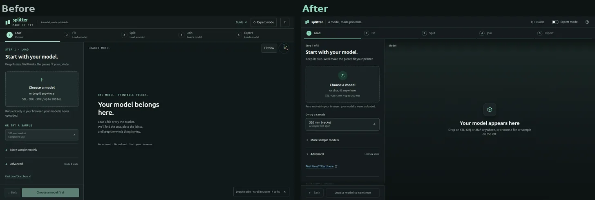 |
| Fit: structured warning, metric grid, full volume on desktop, calmer scene | 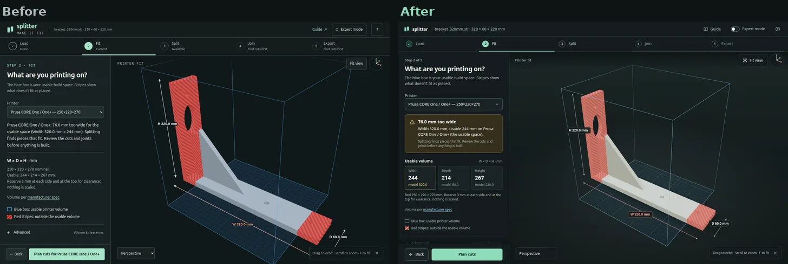 |
| Cut: tool state, fields, part palette | 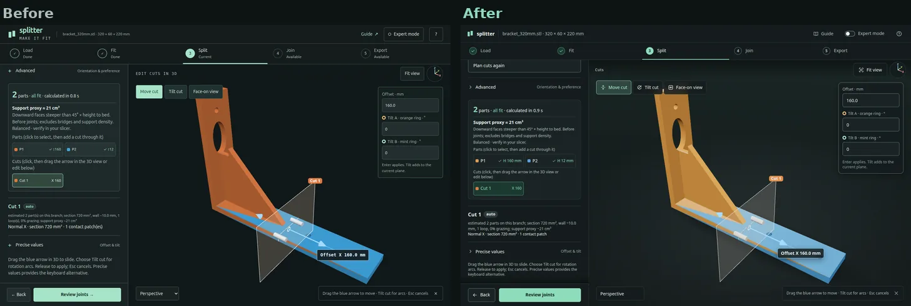 |
| Expert workspace | 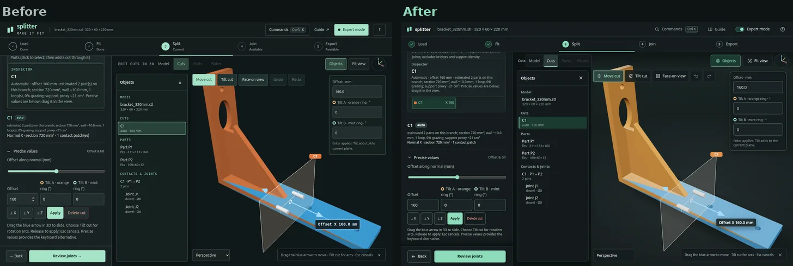 |
| Pin: readable card, depth figure and joint scene | 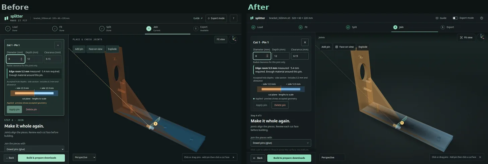 |
| Export: success banner, labelled verification, file rows | 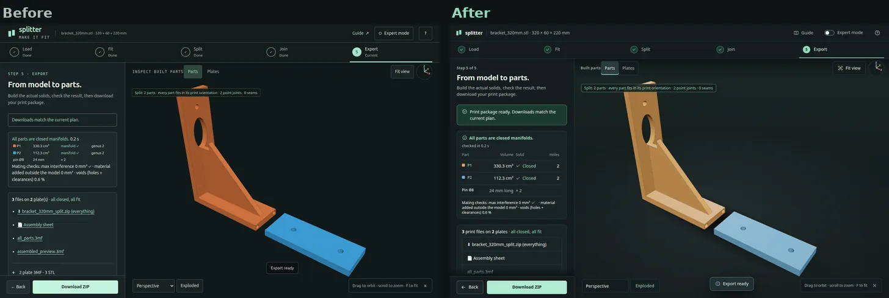 |
| Command palette | 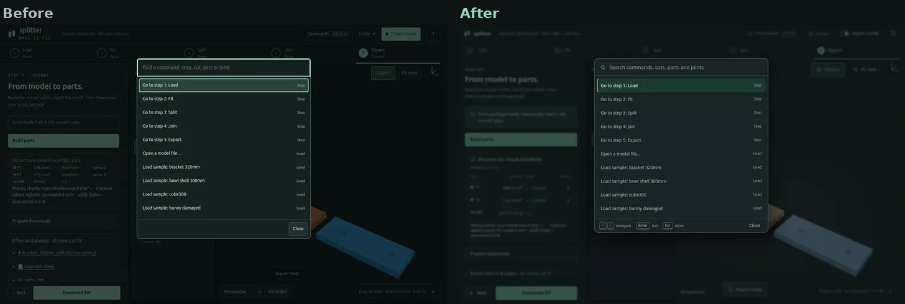 |
| Phone Fit: clean CTA, icon controls, dimension backings | 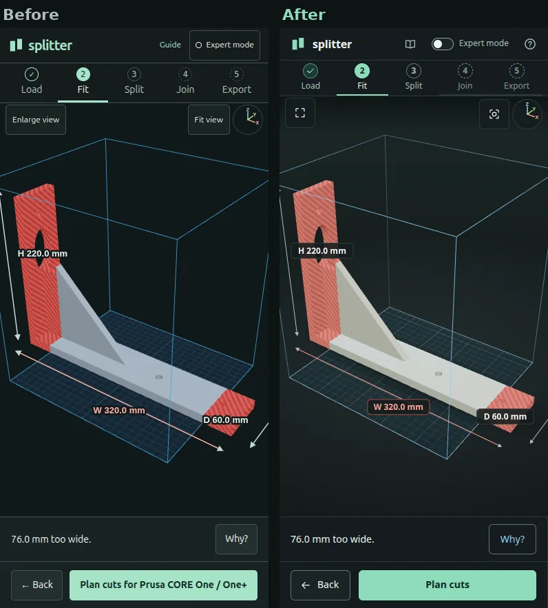 |
| Phone Expert cut: same capabilities, less text chrome | 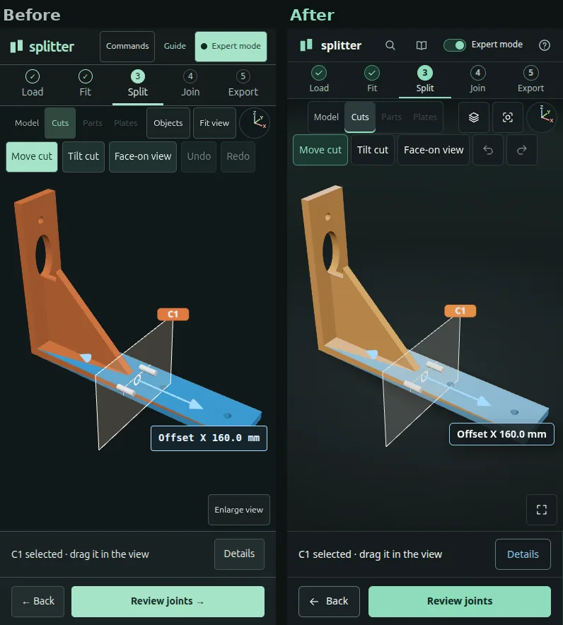 |
| Phone Join | 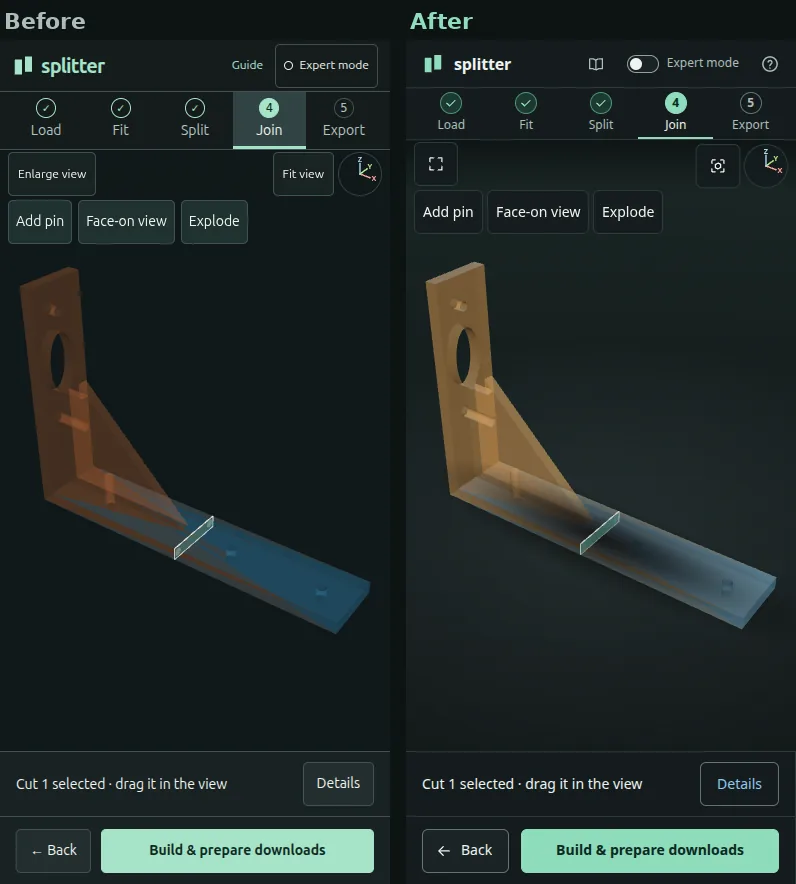 |
| Loading: centred, subject, non-interactive stage indicators | 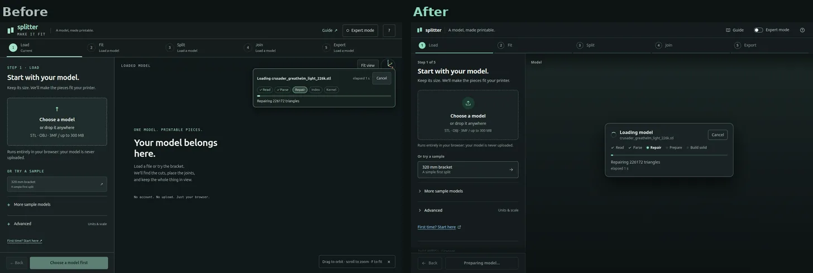 |
| Error: persistent file-specific recovery card |  |
| Error from an open surface | 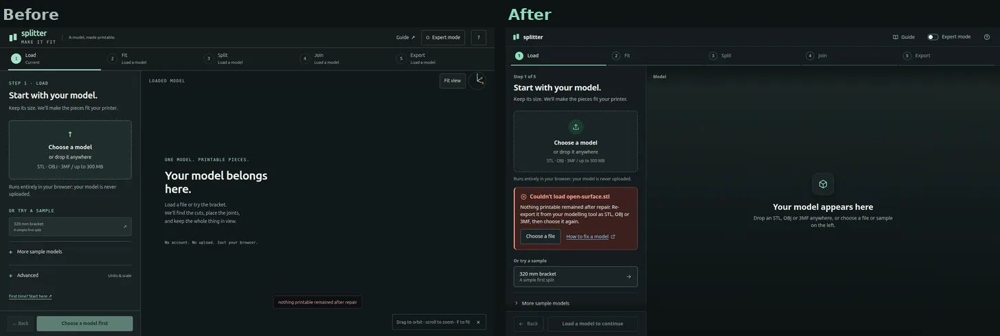 |
| Phone empty state: shorter unused viewport, actual upload above fold | 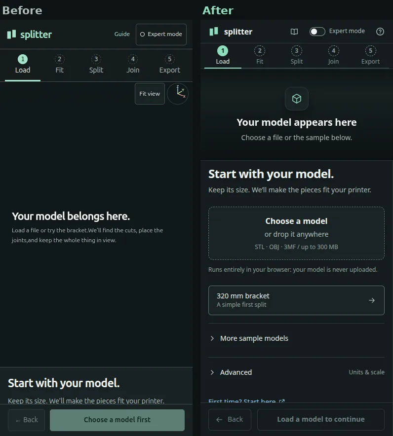 |
| Phone loading | 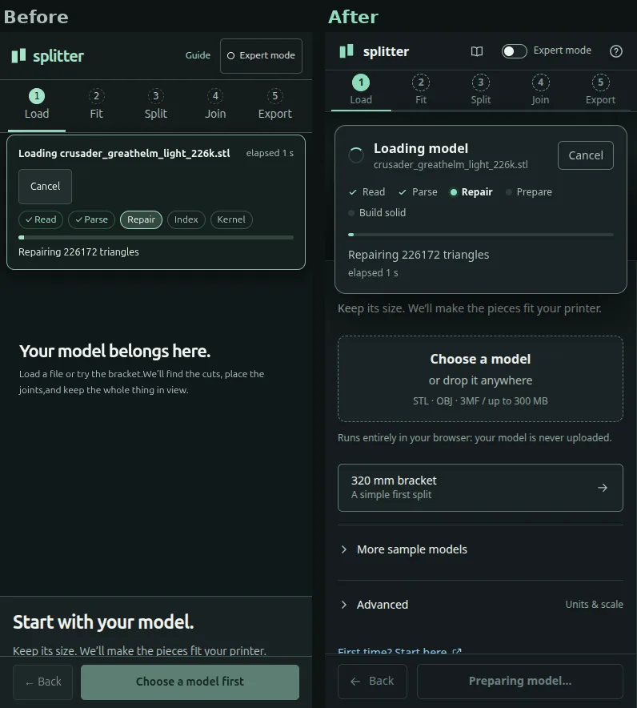 |
| Joint-editor labels | 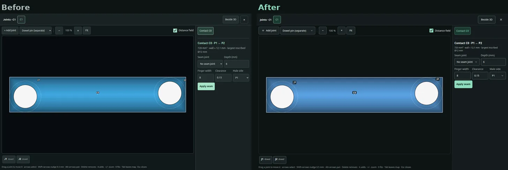 |
| Guide: smaller hero, shorter measure, numbered instruction cards | 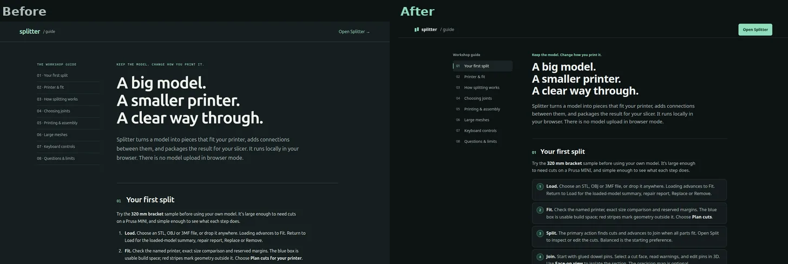 |
| Toast | 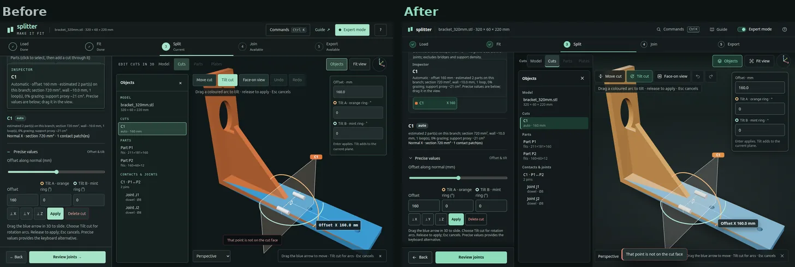 |
| Tilt mode | 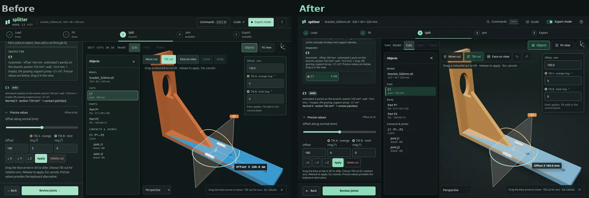 |
| Help: scannable sections and always-visible close | 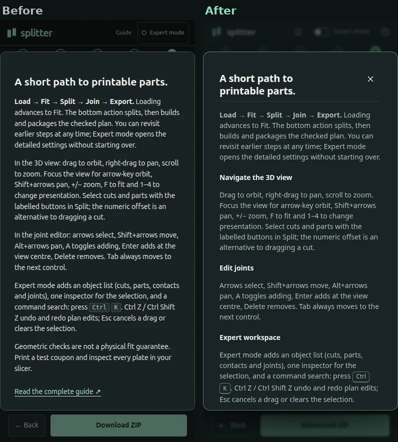 |
| Licenses: consistent dialog and close affordance | 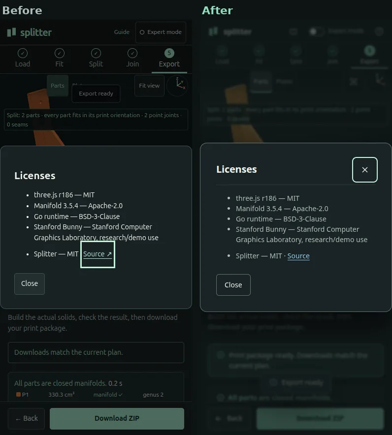 |

## 4. Behavioural changes (no planner/API changes)

1. **No empty camera tools.** Frame, orientation and gesture help appear after a model loads. The dismissed gesture hint remains dismissed across reloads. The empty phone viewport is reduced from about 29% to 22% of screen height.
2. **Load failures persist.** Generic parse/repair failures now produce an alert card naming the file, retaining the actual reported cause and offering a file chooser and repair-guide link. Invalid-format guidance says re-export; confirmed non-closed solids get watertight-repair guidance. This is not a new repair algorithm.
3. **Progress distinguishes the work from the file.** The headline names the operation; the filename is secondary and truncates with its full value in the title. The load footer says “Preparing model…” rather than implying no file was selected. Estimates and stage ids are unchanged.
4. **The next action is “Plan cuts”.** The full printer-specific action remains in its tooltip, and the selected printer is explicit in the Fit panel. This prevents wrapped/orphaned printer names on phones. There is still no empty Continue confirmation.
5. **Desktop simple Fit frames model ∪ build volume.** At stage widths over 760 px, the whole box is visible; at phone and narrow Expert widths, the model-first framing remains. The whole box therefore still extends past the phone edges. This is a deliberate trade-off, not claimed fixed on all viewports.
6. **Cut hover is distinct.** Desktop pointer hover brightens the rim; selection adds fill/pivot/arrow. No geometry or drag semantics changed.
7. **Guide scroll-spy** marks the chapter in view; ordinary anchors still work without JavaScript. Screenshots are regenerated from the app.
8. **Help and licenses have a persistent top close action** as well as the existing footer Close. Help has subheadings for 3D navigation, joints and Expert mode; no shortcut was removed.
9. **Build caches are coherent.** The static build stamps relative module imports and worker URLs, not just app.js; the guide styles are also stamped. Returning users no longer mix a new entry module with cached old dependencies.
10. **Scene dressing cleans up with the model.** Removing/replacing a model removes the floor and shadow and disposes their materials/geometries. Textures are shared, not recreated per render.

The five-step flow, one model/plan/build state, Simple/Expert mode, all **96 baseline control IDs**, precision map, joint types, numeric cut/pin editing, keyboard alternatives, samples, full-detail mesh export, coupon, assembly sheet and every file export remain reachable. See the capability checklist in `MERGE.md`; this pass adds no second navigation.

### Test changes are explicit

Three tests were adjusted for intended presentation changes, not removed: the CTA now asserts **Plan cuts**, with the printer in the tooltip and verdict; open disclosures assert their rotated chevron and actual open state, not the “−” glyph; the gesture-persistence test loads a model before expecting the hint. `design-system.mjs` adds axe, a 12 px type floor, icon names, guide images/scroll-spy, real recovery-file-chooser interaction, coherent module imports and scene removal checks.

## 5. Measurements and verification

Viewport ratios use the existing measurement harness, which projects actual mesh vertices (up to 60k sampled). “Model share” is its visible bounding rectangle as a fraction of the screen, not a subjective claim about clarity. Controls counts include visible native controls even below the panel fold, but exclude inert content. The phone gained one Help button; the visible controls did not silently disappear behind an untested menu.

| State | Merge canvas / model share | Design canvas / model share | Controls: merge → design |
|---|---|---|---|
| Desktop simple Fit | 0.615 / 0.294 | 0.626 / 0.202 | 19 → 19 |
| Desktop simple selected cut | 0.615 / 0.294 | 0.626 / 0.305 | 30 → 30 |
| Desktop simple Export | 0.615 / 0.281 | 0.626 / 0.292 | 25 → 25 |
| Desktop Expert selected cut | 0.44 / 0.354 | 0.451 / 0.360 | 58 → 58 |
| Phone simple Fit | 0.71 / 0.392 | 0.724 / 0.392 | 12 → 13 |
| Phone simple selected cut | 0.71 / 0.392 | 0.724 / 0.392 | 15 → 16 |
| Phone Expert selected cut | 0.71 / 0.392 | 0.724 / 0.392 | 23 → 24 |
| Phone 226k-triangle helmet Fit | 0.71 / 0.530 | 0.724 / 0.530 | 12 → 13 |

The desktop Fit model is intentionally smaller to show the entire printer box; normal editing and Export did not shrink. The phone keeps the 53% helmet and 39.2% bracket model share.

Verification on Chromium / SwiftShader:

- **17/17 browser suites PASS**, including the private 226k-triangle model (fit words, margins, planning, full-detail manifold build and real ZIP download), large-mesh simplification/cancel/restore, all joint families, support preference, WASM, touch and keyboard flows. Run: `SPLITTER_PRIVATE_MODEL=… scripts/e2e-all.sh URL OUTDIR`.
- **4 activations**, keyboard only: sample → Plan cuts → Build & prepare downloads → downloaded ZIP.
- Merge contract: **43 states, 0 axe violations, 0 sub-44 px targets, 0 overlapping/off-screen tested controls, 0 horizontal overflow, 0 JS text leaks**. All 96 baseline IDs remain.
- New design-system suite: **10 states**, axe 0, no rendered text under 12 px in those states; recovery chooser opens; every guide image loads; model removal clears the ground.
- The contract and new design suite also pass on the deployed preview. (The test’s initial Node fetch could not use Chromium’s host resolver; it now checks imports inside the browser, on the same origin as the app.)
- `go test ./...` and `go vet ./...` PASS. No Go source changed.
- No push or public publication. Only the requested preview build and local commits.

## 6. Re-critique and honest gaps

The repeated visual reviews judged the final Fit/Export/Expert-cut screens around **8/10**, and phone Fit/Join around **7–7.5/10**. Those are qualitative model critiques, not an objective benchmark or a human acceptance. The largest improvements are the information hierarchy, error recovery, type consistency and the quieter, better-framed desktop scene. I would not claim Figma/Onshape parity.

Remaining gaps, in order:

1. **Phone Expert chrome remains dense.** Four presentation tabs, Objects, Frame, triad, editing tools and history remain available with 44 px targets. I did not hide capabilities to make screenshots look cleaner. Some visible labels became named icons; a human touch-usability review is still worthwhile.
2. ~~Phone Fit keeps the model large, not the whole box.~~ Resolved in round 2 (§7): every screen size now frames model ∪ volume ∪ dimension lines.
3. **Join rendering is still an inspection compromise.** Opacity rose from 0.20 to 0.42, but transparent parts and small pins can be muddy in perspective. Face-on and Explode expose the mechanics; no new local clipping/section renderer was invented for this pass.
4. **Grounding is AO-like, not physical AO.** A shared radial footprint shadow and faint floor are inexpensive and preserve browser performance, but exploded parts can still appear suspended. This is not a ray-traced shadow claim.
5. **The palette remains a flat launcher.** It has clearer selection, type and keyboard hints but no new recency/ranking engine or collapsible command groups.
6. **Dense engineering details remain in Expert mode and the pin inspector.** The table and main fit decision are clearer; not every planner-generated sentence was rewritten. Per-side hole depth still uses the solver’s signed-side convention, with the accepted depth figure and end-allowance caption.
7. **Stylesheet layering remains.** Tokens replace most colour/type one-offs, but the historical layout sheets still carry some spacing/radius overrides. A wholesale CSS rewrite would be a separate riskier change, not a claim made here.
8. **Scope of evidence.** Axe and screenshots are not a screen-reader session or a real phone hardware test. Screenshots with panel content at a scroll boundary are not proof of overlapping controls: DOM bounds and scroll reachability were checked separately. No physical print was produced in this UI pass.

## 7. Round 2: decision clarity and composition

Two reviews of the first design build asked for the same kind of change: less prettiness work and more decision clarity. The review of the app as an artifact found two filled primaries for one action on desktop Split before planning, pre-plan copy that described cuts that did not exist yet, and a phone Fit view that cropped the build box and the depth arrow. Control's review (desktop 8/10, phone 7.5/10) asked for six things in order: resolve the fit decision, use one self-contained headline, fix the viewport composition and lighting, add panel bottom clearance, enlarge small text and utility icons, then reduce Expert density and Join transparency where that was cheap. This section records what changed, what was measured and what remains.

### 7.1 The fit decision is now a decision

**Finding.** The private 226k-triangle helmet showed "9.8 mm too deep … Splitting finds pieces that fit." That was misleading: it is 197.2 × 223.8 × 241.8 mm against 244 × 214 × 267 mm usable, so it fits **in one piece turned 90° on the bed**. I checked that against the real planner: with the default Balanced preference, Plan cuts returns **one part** for the helmet on the CORE One. The old copy pointed the user towards cutting a model that needs no cut.

**Change.**
- The verdict is computed once (`fitAssess` in `flow.js`) and states the result first: **"Doesn't fit as placed: 9.8 mm too deep"**, then the measured line **"Depth 223.8 / 214.0 mm usable on Prusa CORE One / One+"**, then the consequence.
- It checks the six axis-aligned orientations the planner itself considers for a whole model (two when "Keep all parts upright" is set, matching `candidateDowns`). If a quarter turn fits, the card offers it as a real action: **Turn 90° on the bed** or **Lay it on its side**. The model is then rotated in the backend (new `rotate` in WASM and `POST /api/models/{id}/rotate` on the server). This is a signed permutation validated to det +1, so it never mirrors, and it applies to the repaired mesh and to any kept full-detail original. Planning, the geometry kernel and exports therefore all see the same orientation. Afterwards the card reads **"Fits as turned"** with **Restore file orientation**, and a cancel/restore reload reapplies the turn.
- If no quarter turn fits, the copy says so and states what happens next: "No orientation fits it whole. Plan cuts proposes cuts and a print orientation for each piece; you review them before anything is built." If the model fits as placed, it says no cut is needed and that Plan cuts only adds one when the Split preference trades a cut for less support. That is the planner's actual behaviour.
- After planning, a one-piece result says **"No cut needed: it prints in one piece in the orientation shown"** instead of "Review the suggested cuts".
- The rotate offer is a secondary button. **Plan cuts** stays the single primary because it also reaches the one-piece result: it tries orientations before cutting. One reviewer preferred Rotate as the primary. I kept one step action per view and made the copy say what Plan cuts does.

**Why not further.** The axis-aligned check can miss a diagonal fit that the planner (with tilted orientations) finds. The copy says "No orientation fits it whole" only for the axis-aligned set the planner uses by default. The planner remains the authority.

### 7.2 One primary per view, one label per action

- On desktop Split before planning, `#autoSplit` "Plan cuts automatically" and the footer "Plan cuts" were both filled mint. Now the in-panel button is labelled **Plan cuts** and is the only primary, and the footer's identical action is hidden while Split still needs a plan. On a phone peek, where the panel button is hidden, the footer keeps it.
- Pre-plan Split copy is state-specific: "Choose what matters more, then Plan cuts. You review the proposed cuts here before anything is built." The help link reads "How cuts are chosen" until cuts exist, then "Why these cuts?". Changed settings produce "Plan cuts again to apply them". "Find cuts again" was renamed to match.
- The new contract assertion found a case nobody had reported: an open pin popover showed **pinApply + footer** (and, in Expert, **pinApply + seamApply + jApply**) as filled primaries. Local form commits (cut, seam and joint Apply, Auto-split this part) are now **confirm** buttons, an accent outline, and the footer steps down to secondary while a local editor's primary is visible.
- **Test:** `merge-expert.mjs` asserts that every audited state, now **47** (43 + 4 pre-plan Split states), has at most one visible `.primary` outside an open modal. It also asserts that the pre-plan copy never mentions suggested cuts. `design-r2.mjs` asserts **exactly one** primary on Split before planning at all three sizes.

### 7.3 Viewport composition and lighting

- **Framing.** Fit frames model ∪ usable volume ∪ dimension lines on every screen size, not just desktop (`viewer.fitGeometry()` is shared by framing and annotations). New `fitFrameMargin()` projects all eight volume corners and all dimension-line ends: the smallest distance to the canvas edge is **71 px** at 1440×900, **54 px** at 1280×720 and **53 px** at 390×844 (helmet). Before, the phone label edge minimum was **−123 px**, meaning a label sat 123 px outside the viewport.
- **Cost, measured** (`merge-measure.mjs`, bracket sample on Prusa MINI). Showing the whole volume and the label lanes makes the model smaller on **Fit only**. Phone Fit model share fell from 0.392 to **0.123**, because a 320 mm bracket next to a 180 mm volume makes a wide union. Desktop simple Fit fell from 0.202 to **0.146**, and the phone Fit canvas from 0.724 to **0.681**, because the summary row is now two lines. Split, Cut, Join and Export are unchanged (phone 0.392, desktop 0.305). The reviewers asked for this trade on the comparison step. Editing steps keep model-first framing. On Fit, Fit view (F) reframes the same union, while pinch or scroll zoom still reaches model detail.
- **Labels.** Labels are pushed away from the projected centre of model ∪ volume and kept at least 12 px inside the view. They are placed with a 6 px collision gap, failing axis last, and drawn after all lines so no arrow crosses a pill. The failing axis reads **"D 223.8 / 214.0 mm usable"** in a red pill with a 2 px line, while passing axes use a muted 1 px line and text. Measured: 0 label overlaps and ≥ 12 px edge clearance at all three sizes (helmet and bracket).
- **Exceeded face.** Each box face the model crosses gets a translucent red wall and a solid outline. The legend chip moved into the viewport: Usable build volume / Model outside it / Exceeded side. Because the volume is centred on the model, an over-deep model crosses both front and back faces, and both are highlighted. That is true, but busier than a single face.
- **Overflow hatch.** A wider, two-tone hatch (light coral / deep red, modulated by the lit value) replaces the 62 % tint, so the overflow keeps its shape cues but no longer blends into pale model regions.
- **Lighting.** The hemisphere fill dropped from 1.15 to 0.60 and the key is lower (elevation ≈ 25°). A cool fill sits at camera right, and a soft point key at 0.75 × the model diagonal adds distance falloff, so large up-facing areas get a gradient instead of a uniform value. It remains four analytic lights and one point light with no shadow maps, a small cost on an iGPU. The helmet crown is now light-to-mid grey with a gradient. Reviewers still call it "subtle", which is true of a near-planar crown without AO.

### 7.4 Panel bottom clearance

At 1280×720 the Fit panel's last rows sat under the sticky footer with no cue. The panel now has 48 px end padding. A bottom fade and a **More below** pill straddling the footer edge appear only while content continues (`data-more` from scroll and resize/mutation observers) and disappear at the end. Measured with Advanced open and scrolled to the end: the last row ends **141 px** above the footer at 1440×900 and **141 px** at 1280×720. `design-r2.mjs` asserts ≥ 8 px, that the pill is absent at the end and that it is present at the top.

### 7.5 Small text and utility icons

- Supporting text (`.small`, readout notes, metric labels, printer source) rose from 12 to **13 px** and the muted text colour from `--text-subtle` to `--text-muted`. The usable value under each metric now reads "of 244.0 usable" on its own line, which removes the inconsistent wrap.
- Phone header: Guide and Help are 48 × 48 px with a visible 12 px label under the icon (the 12 px floor is enforced by `design-system.mjs`). Viewport icon buttons, Objects and Enlarge view have tooltips in addition to their accessible names. Future-step markers were measured in round 1 (9.6:1 inactive, 5.93:1 disabled) and are unchanged.
- Phone summary row: the verdict headline is **16 px semibold** in the warning colour, with the remedy or next step on a second 13 px line, for example "Doesn't fit as placed: 9.8 mm too deep / Fits in one piece if turned 90° on the bed". The repeated paragraph, cards, legend and badge were reduced to one headline, one measured line, one consequence and one legend.

### 7.6 Before / after (round 2)

Before is left, after is right. "Before" is the first design build, fb606e0. The committed images use the public bracket sample. The private helmet pairs are in the review gallery only and are not committed.

| Item | Pair |
|---|---|
| Fit verdict, framing, labels, exceeded face · 1440×900 | 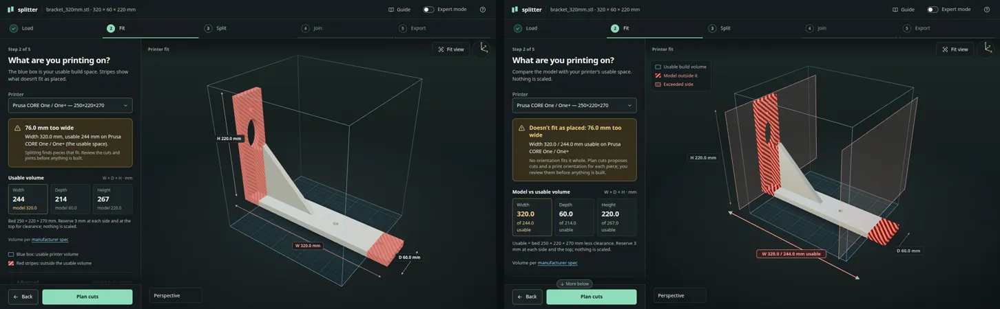 |
| Same + panel fade / More below · 1280×720 | 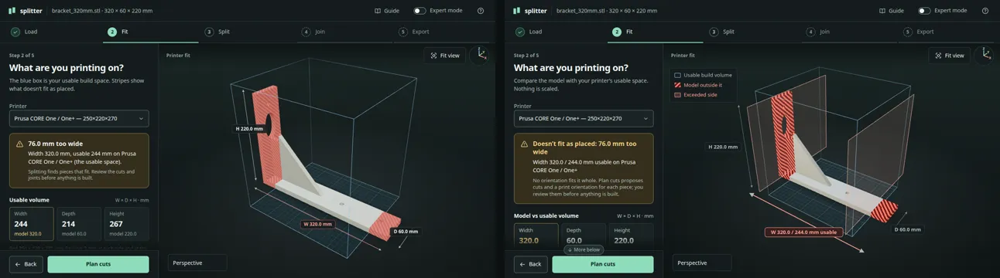 |
| Phone Fit: whole box, headline summary, labelled header utilities · 390×844 | 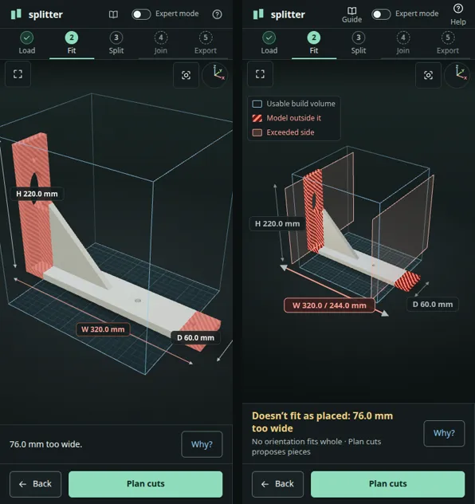 |
| Split before planning: one primary, pre-plan copy · 1440×900 | 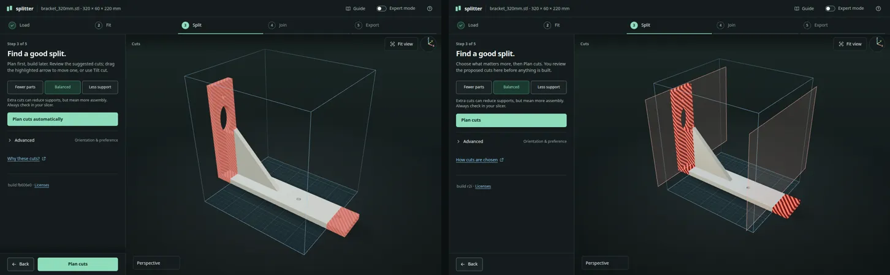 |
| Split before planning · 1280×720 | 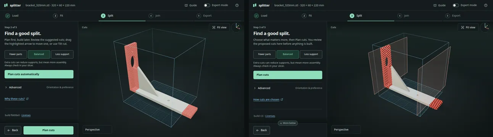 |
| Split before planning · phone | 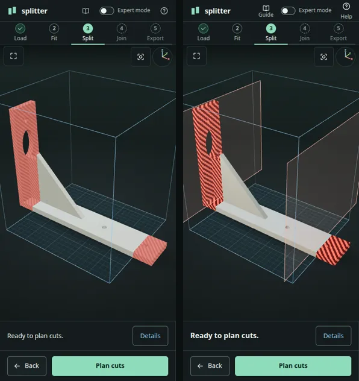 |
| Panel end with Advanced open · 1440×900 |  |
| Panel end with Advanced open · 1280×720 | 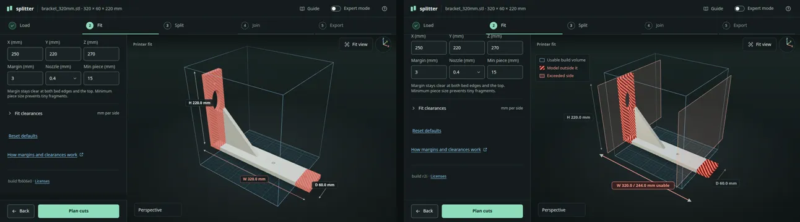 |
| New: after **Turn 90° on the bed** (custom 70 × 330 × 230 bed) · 1440×900 | 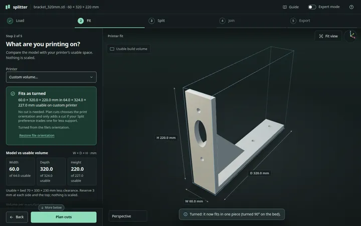 |
| New: turned · 1280×720 | 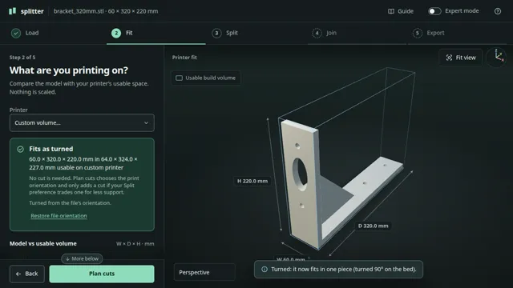 |
| New: turned · phone | 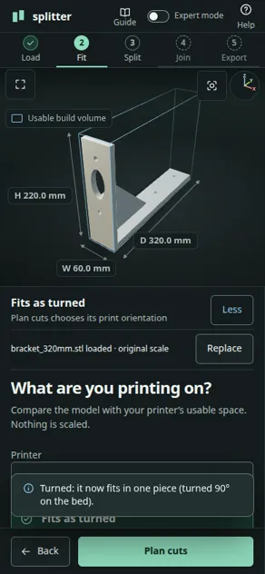 |

### 7.7 Verification

- `go test ./...` and `go vet ./...` (including `GOOS=js GOARCH=wasm go vet ./cmd/splitter-wasm`) PASS. New Go tests: `geom.QuarterTurn` accepts the four quarter-turn cases and rejects mirrors, scaling, repeated columns, short input and non-integer rotations. The server rotate test swaps W and D on a scaled box, keeps the scale, keeps the mesh closed with positive volume and rejects bad input with HTTP 400.
- New `e2e/design-r2.mjs`: **52 checks** at 1440×900, 1280×720 and 390×844. It covers the verdict headline, honest next step, rotate offer only when a quarter turn fits, applying the turn (W and D swap), the turned model planning as **one piece**, restoring the file orientation, framing margins, label clearance and overlap, failing-axis-only emphasis, one primary, pre-plan copy, panel end clearance and the More below behaviour.
- The full browser suite (`scripts/e2e-all.sh`, now 18 suites with `design-r2`) is reported in the commit/handoff with the private-model check. Reproduce the captures with `e2e/design-r2-pairs.mjs` (bracket, any build) and `e2e/design-r2-shots.mjs` (any STL, with metrics).

### 7.8 Honest gaps after round 2

1. **Rotate vs Plan cuts.** Two visual reviews would make Rotate the primary when it alone fixes the fit. I kept Plan cuts as the single step action because it reaches the same one-piece result and keeps one primary and one label per step. This is a judgement call. A human usability check should decide it.
2. **Two highlighted faces** for an over-deep, centred model (front and back) are correct, but they read busier than a single "exceeded side".
3. **Crown shading** is a gradient, not AO. Near-planar tops still read fairly flat at phone size.
4. **Phone Expert density and Join transparency** (item 6) were not changed in this round. They need their own visual work and touch testing, and squeezing them in here would have been guesswork.
5. **Fit is model-smaller by design** (phone bracket 0.392 → 0.123). On Fit there is no one-tap model-only framing; zoom gets there. A two-state Fit camera (volume ⇄ model) would be the natural follow-up.
6. **Toasts** on phone can briefly cover the expanded sheet. This is pre-existing and transient.
7. Evidence remains screenshots, DOM measurements and axe on Chromium/SwiftShader. No real-device, screen-reader or physical-print test was done.
