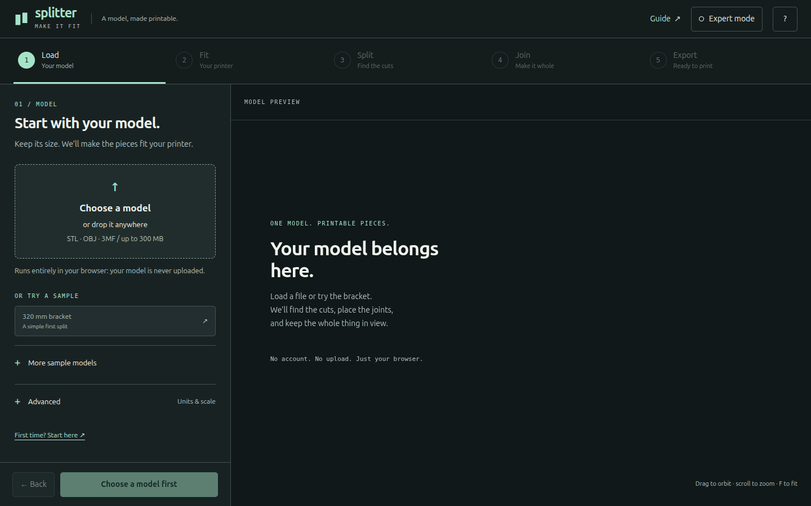
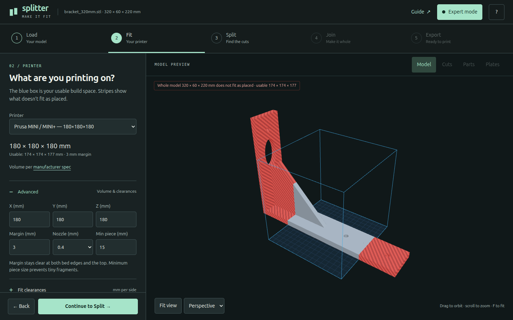
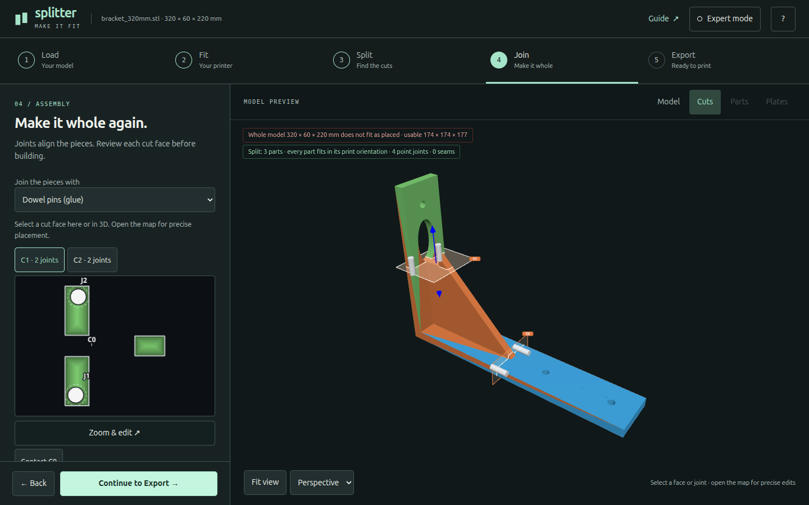
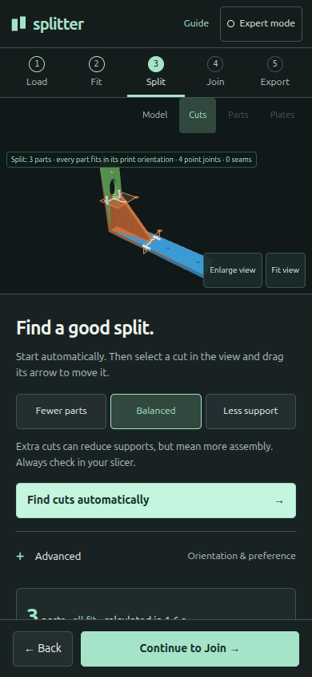
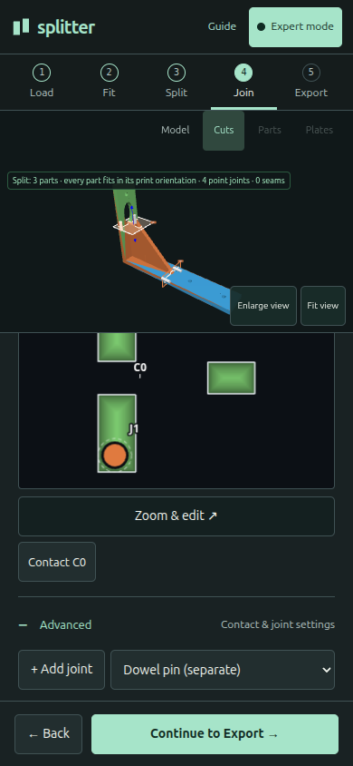
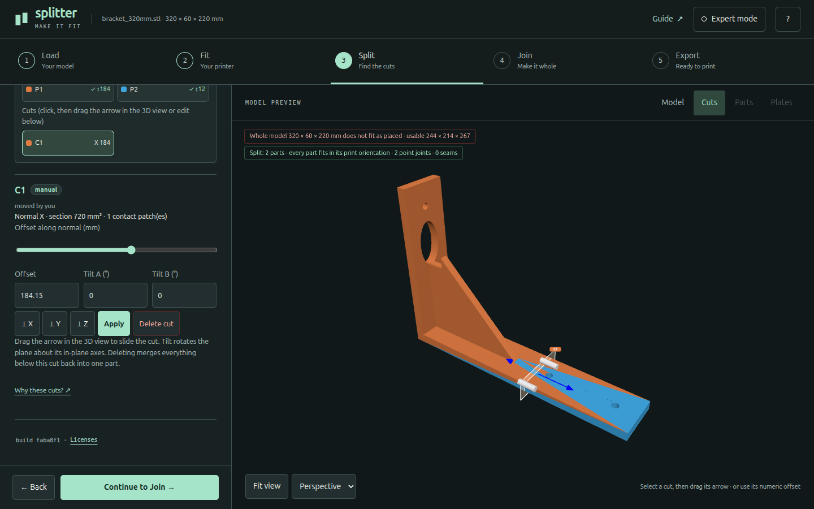
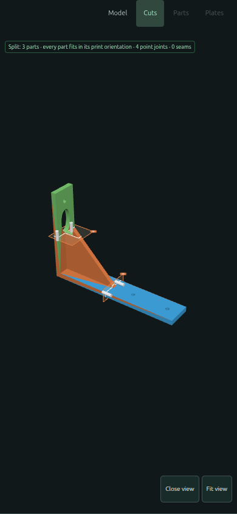

# Lane B · Round 1

## The proposal: guided work, with expert depth

**Load → Fit → Split → Join → Export.** One decision at a time, one model, one plan. Expert mode opens the detailed settings in each step; it does not switch algorithms, reset work or take the user to a different application.

This is a working browser application, not a concept mock-up. The implementation is in `faba8f1`, following the committed inventory and failing workflow test in `f1f67f0`. The Go planner and WASM API are unchanged. The only Go change embeds the new guide and its images in the server distribution.

### Why this layout

The old interface asks a beginner to distinguish settings, actions, inspectors and outputs in a long stack. Lane B makes the order explicit while keeping the model visible. A fixed next action removes the question “which button now?” and prerequisite gating prevents empty Join/Export screens.

The visual language is a quiet workshop: charcoal-green canvas, restrained mint actions, measured type, numbered steps and plain technical language. It is intentionally not a professional CAD shell. Advanced controls live where the relevant decision is made, rather than in a separate settings application.

The trade-off is deliberate: **more explicit confirmations, fewer simultaneous decisions.** This lane does not win on minimum click count. It should be judged on orientation, recovery, discoverability and continuity between simple and expert use.

## What changed

- Replaced the five simultaneously stacked panels with five navigable steps, prerequisite checks and a persistent Back/Continue row.
- Added one-click Expert mode, persisted independently of printer settings. Per-step Advanced disclosures remain available in Guided mode.
- Replaced the prominent support slider with Fewer parts / Balanced / Less support choices; retained the precise slider in Advanced.
- Kept all four 3D presentations. Added keyboard camera controls, camera direction presets, fit-to-view, an assembled/exploded toggle and an enlarged phone viewport.
- Kept direct 3D cut dragging and backed it with native cut/part buttons and numeric editing. Added native contact selectors, including contacts with no point joints.
- Fixed the joint editor's Tab trap, added keyboard map panning, kept progress/cancel inside the dialog's accessible subtree, and restored focus after edits and closing.
- Moved the map edit action below the canvas so it cannot cover contact labels. Noninteractive warnings no longer intercept pointer input or cover phone settings.
- Added a stale-plan warning after printer/fit changes and prevent exports until recalculated. Cancelling a plan restores the model without jumping back to Load.
- Added focus styles, 44 px control targets, live progress/result announcements, reduced-motion camera/progress behaviour and semantic modal/step states.
- Added an eight-chapter [guide](../../web/guide.html), contextual links and screenshots from real samples: first split, printer/fit, splitting, joints, printing/assembly, large meshes, keyboard controls and FAQ.
- Kept the large-mesh simplification disclosure, original/simplified export choice, recovery reports, coupon generator and every existing export format.

## Capability checklist — pass for reachability

The complete [39-row inventory and migration map](inventory.md) was written before implementation. Every row has a destination and an evidence level; no capability is intentionally removed. The baseline's **38 named static controls** and every dynamic ID from the original application script remain present. Every one of the **13 joint-style presets** was selected through the real UI, with the original cuts preserved.

Reachability is not the same as exhaustively revalidating every geometry combination. The checklist distinguishes browser-exercised behaviour from unchanged, mapped controls. For example, unit scaling was exercised, while every supported source-format encoding was not re-tested; the parser is unchanged.

## Measurements

Baseline `e404028`; same 1440 × 900 viewport, fresh storage, default printer and bracket sample. Counted buttons, inputs, selects, summaries and links with rendered CSS layout, including disabled controls. “In viewport” additionally requires the complete bounding rectangle to be visible. The after count includes the transparent, keyboard-accessible file chooser and the off-screen skip link in the rendered total, so it does not artificially remove navigation/accessibility controls.

| State | Before: rendered / in viewport | Guided: rendered / in viewport |
|---|---:|---:|
| Empty, ready to load | 30 / 24 | 17 / 16 |
| Plan ready | 44 / 24 | 27 / 24 |

The plan-ready viewport count is unchanged: the newly exposed controls are workflow navigation and contextual selection rather than unrelated setup panels. The scroll-exposed total falls substantially; there is no claim that every screen has fewer controls.

| Measure | Result |
|---|---|
| Simple path, sample load → ZIP download | **9 activations**, versus 5 baseline actions |
| Steps | 5, with four explicit Continue actions |
| Main-app automated a11y states | 24: desktop/phone, guided/expert, dialogs and enlarged viewer |
| Guide automated a11y states | 2: desktop and phone |
| axe violations in these states | **0** |
| Controls below 44 px in the app audit | **0** |
| Horizontal-overflow states | **0** |
| Keyboard-only end-to-end path | Passed, real Tab/Enter events and actual ZIP download |

The action count excludes optional editing, printer changes and the operating system's file chooser. The test also opens/closes the joint editor and toggles Expert; those optional actions are excluded from the simple-path number. The guided test does not use scripted focus or clicks to activate the path.

See [machine-readable measurements](measurements.json) for the definitions and actual values.

## Execution evidence

Fresh `go test -count=1 ./...`, `go vet ./...`, JavaScript syntax checks, `git diff --check`, static build and the pinned QA dependency audit passed. Browser checks ran in Chromium with software WebGL, at **1440 × 900** and **390 × 844**, with additional width regressions at 360, 390, 412 and 1440 px.

| Test | What actually ran |
|---|---|
| `guided-flow.mjs` | Keyboard-only sample → Fit → Split → Join/map → Build → actual ZIP download; Expert preserves built parts |
| `ux-audit.mjs` | 24 app states; axe WCAG 2/2.1/2.2 A/AA tags plus best practices; targets; overflow; cut offset; stale-printer gate; reduced-motion change |
| `interactions.mjs` | Real pointer hit and 3D gizmo drag; camera keys; joint 0.5 mm nudge and map pan; coupon download; phone expansion/escape; scroll-to-final-content; guide links/images/a11y |
| `expert-controls.mjs` | Scale 100 → 200 → 100%; custom volume/nozzle/fit inputs; all 13 joint presets; deleting joints/cuts; manual cut; auto-completion; explosion |
| `smoke.mjs` | Real WASM plan, Manifold build and ZIP; three fitting parts on MINI, no non-manifold parts |
| `joints.mjs` | Defaults/persistence/reset; change style without moving cuts; bowl fallback warnings; force one contact without overwriting others |
| `mobile-ui.mjs` | Real contact-label glyph bounds/hits, keyboard contact selectors, all four view buttons, support slider pointer/keyboard access |
| `support.mjs` | Bowl/MINI: preference 0 produces four parts, 0.5 produces six; lower support proxy; both built and exported |
| `large-mesh.mjs` | Broken-mesh explanation; 720k → 400k simplification with measured deviation; staged plan progress; cancel/restore; editor zoom/wheel/add/dock; original-detail manifold build; phone editor |

**Real test geometry:** a 226,172-triangle model completed load, plan, build and export through the nested HTTPS preview. It produced **four fitting, manifold pieces, 20 export files and four plates**. Total observed time was **57.1 seconds**, including about 45 seconds of planning on this test machine. This is one observation, not a performance guarantee. Its source geometry and output meshes were not added to the repository.

The synthetic 720k torus simplified to 400k triangles with a measured maximum sampled deviation of about 0.0033 mm, then built from its retained full-detail original. The runtime completed cancel-and-restore and resumed from Split.

The actual deployed nested path was browser-tested for the full keyboard download flow, direct interactions, real test geometry, guide images and all a11y states—not merely checked for an HTTP 200. The local verifier needed an explicit host-to-address mapping; no application URL or resource path was rewritten.

### Red → green and test changes

The first committed workflow test failed on the untouched baseline with `five visible workflow steps: 0 !== 5`. The same behavioural test now passes. Its later change only permits a configurable browser hostname resolver; no assertion was removed.

Existing tests were adapted to navigate steps and open Advanced before interacting. The old joint-map Tab selection assertion changed to Arrow selection because Tab must leave a canvas. The mobile map test now uses the live plan rather than an absent external JSON fixture. The support test accepts an explicit printer: the shipped bowl on Core One has identical plans at both weights, so the known MINI comparison is used without weakening its “fewer supports, more parts” assertions.

Tests exposed and drove fixes for: returning to Load after cancellation, modal editor reparenting, map actions intercepting contact labels, warning toasts intercepting the slider, and an invalid dialog role on the expanded viewport's original semantic element. All are re-exercised in the passing suites.

## Screenshots

These are actual browser captures; no screenshot is a design mock-up. The guide images use shipped samples only.

### Guided desktop

### Expert depth, same workflow

### Joining, with map actions outside geometry

### Phone guided and expert

### Direct interaction and phone inspection

The sidebar is an independent scroll region, not an overlay behind the footer. A partially visible row at its scroll boundary is a scroll cue, not proof that the final control is unreachable: both pointer/keyboard interaction and the final-content-above-footer bounds were tested.

## Honest gaps and review priorities

1. **Not a WCAG certification.** Automated checks and keyboard tests passed; a real screen-reader/assistive-technology audit has not been performed. Canvas geometry still needs descriptive alternatives beyond generic model measurements for users who cannot see the model.
2. **The phone overview is intentionally compact.** Enlarge view gives more space for inspection, and numeric/native controls are the reliable alternative to small 3D handles. Real-device touch/pinch performance and Safari/Firefox were not tested in this round.
3. **Expert mode stays inside the flow.** It reveals depth rather than becoming an always-open CAD inspector. Frequent users may prefer a competing lane; this is a design trade-off to review, not an omitted setting.
4. **No project-session persistence.** Printer preferences and Expert mode persist; loaded geometry and manual edits do not survive reload. The guide states this existing limitation explicitly.
5. **Geometry evidence is not fabrication evidence.** The generated coupon and models were not physically printed. Joint strength, actual fit, hardware access and slicer supports still require independent checks.
6. **Documentation is first-pass.** The guide has four real sample screenshots and plain-language limitations, but does not yet illustrate every joint family or cover every printer/material calibration.

The next review should decide whether the explicit confirmations and persistent model make this lane more understandable than a viewer-first or workspace/inspector approach—and whether that clarity is worth the extra actions for frequent users.
