# Lane B — round 2

## Result

**The guided path is now four activations from the bracket sample to an actual downloaded ZIP, down from nine in round 1 and five in the original interface.** The five steps remain visible; they now explain the work rather than add confirmations. All six requested core edits are available in the viewport, including a small contextual pin inspector. The full capability inventory remains mapped and exercised at its stated evidence level.

This is still a **Configure** flow, not a second CAD workspace. It retains the workshop palette, plain-language voice and one-click Expert depth. No public release was made.

## Changes and decisions

### Faster, without skipping the important decision

1. **Load** the bracket sample: the app advances to **Fit**, naming the default printer and showing the exact dimension failure.
2. **Split for Prusa CORE One / One+**: calculate cuts and advance to **Join** when the pieces fit.
3. **Build & prepare downloads**: the user accepts the joints; build the solids, check their statuses and package them in **Export**.
4. **Download ZIP**: save the real package.

There is still a deliberate joint-review decision. Build and packaging have not become automatic side effects of uploading a model. Failed fits stay at Split. Invalid pin warnings, stale printer settings and unapplied pin fields prevent building through the main action. Individual Build and Prepare controls remain available.

Every step is clickable when its prerequisites are met. Done/current/upcoming/blocked are explicit, with a reason on blocked controls. In simple mode, the current step chooses the viewer presentation; Export offers Parts/Plates. Expert exposes all four **view-only** presentations. That resolves the two competing navigation systems without removing a capability.

### A loaded model, not an upload form

Returning to Load shows the model name, dimensions, triangle count, watertight/repair information and **Replace / Remove**. The drop zone and sample chooser disappear until Remove. Removing also clears the actual Three.js scene, history and outputs—not merely the text. The loaded phone layout gives the viewport more height. A simplified model's planning/export disclosure is repeated in Fit so auto-advance does not hide it.

### Explain the fit

The view labels both **Printer build volume** and **Outside usable build volume**. Fit names the printer and spells out the failed dimension—for example, **Width 320.0 mm > usable 244 mm**—rather than presenting a generic failure. Nominal and usable dimensions sit together with the explanation that the margin reserves space at each side and the top. The model is not silently scaled.

### Edit the object

- **Cuts:** select a cut, drag its screen-stable normal handle, or choose **Tilt cut** and drag a rotation arc. A live millimetre/degree readout explains release-to-apply and Esc-to-cancel. Numeric offset/tilt is a **Precise values** disclosure and remains the keyboard alternative.
- **Pins:** choose Add pin and click a cut face; drag a pin across that face. The preview shows required edge room. Red feedback rejects points outside material, in holes, too close to edges or overlapping another pin. Drilling-depth checks still happen in the planner after release.
- **Context:** selecting a pin opens diameter/depth/individual-clearance/delete controls in the viewer. The popover disappears during a gesture and returns on release; a regression checks that it does not cover any of the three test pin footprints.
- **Focus:** Face-on view isolates actual cut material, preserving holes; it is a camera/isolation helper in the same 3D scene, not the separate map. This isolation survives replanning. Fit view restores the model context.
- **Visual honesty:** Join displays thin **pin footprints**, not misleading full-depth cylinders protruding through a close-up camera. The nearby note explains that the built parts show drilling depth. Explode builds real solids if needed, then shows them separated.
- **Precision:** the 2D map is optional. Hover and selection are shared with 3D. Contact selectors still work for seam-only faces. Simple names are “Cut 1 · Pin 2”; technical IDs remain available in Expert.
- **Recovery:** Undo/Redo stores up to 20 accepted plans, not transient pointer previews. Restoration invalidates built/downloaded geometry. New files or changed printer/style settings start a new history. History is not session persistence.

### Small, backward-compatible planner addition

The only planner change is optional `clearOverride` on an individual joint. Absence retains the existing fit-table value; explicit zero is meaningful; negative and greater-than-1 mm overrides fall back to the fit table. The resolved clearance participates in the required footprint as before. This was needed for the requested per-pin clearance control; no existing API field changed meaning. Wire-format tests cover legacy, zero, individual and invalid overrides.

## Measurements

Measurements use Chromium with software WebGL, 1440 × 900 desktop and 390 × 844 phone. Controls are buttons, inputs, selects, summaries and links with visible layout; “in view” requires the full rectangle within the viewport. Disabled controls count. Geometry handles are counted separately below, not as DOM controls.

| Measure | Round 1 | Round 2 |
|---|---:|---:|
| Sample → downloaded ZIP | 9 activations | **4 activations** |
| Empty desktop: rendered / fully in view | 16 / 16 | 16 / 15 |
| Fit desktop: rendered / fully in view | 22 / 22 | **18 / 17** |
| Split desktop: rendered / fully in view | 28 / 24 | **26 / 22** |
| Join desktop: rendered / fully in view | 25 / 21 | **28 / 26** |
| Export desktop: rendered / fully in view | 28 / 23 | **26 / 21** |
| Fit phone: rendered / fully in view | 21 / 19 | **17 / 12** |
| Main-app axe audit states | 24 reported | **30** |
| Main-app axe violations | 0 | **0** |
| Under-44-px DOM targets in those states | 0 | **0** |
| Horizontal-overflow states | 0 | **0** |

The control-count comparison uses saved round-1 audit rows, not a mental estimate. Round 1's headline empty-state count included a differently counted skip/file input; this table uses the same stored audit definitions on both sides. **Join has more exposed controls**, intentionally: direct editing and history replaced mandatory map work. This is not a claim that every screen has fewer buttons. The 30 states add the new pin popover, isolated face and precision disclosure to desktop/phone, simple/expert, dialogs and enlarged-view coverage. Automated results are not a WCAG conformance certification.

Machine-readable audit and count data: [measurements-round2.json](measurements-round2.json).

### 3D versus panel

| Core edit | Round 1 | Round 2, real input verified |
|---|---|---|
| Move cut | Viewport normal handle | Viewport handle; release commits; Esc restores |
| Tilt cut | Panel values | **Viewport rotation arc**, with changed plane-normal assertion |
| Add joint | Separate map | **Click the face in the viewport** |
| Move joint | Separate map | **Pointer/touch drag on the face** |
| Delete joint | Panel/map editor | **Viewport contextual popover** |
| Select part | Viewport | Viewport; actual mesh triangle picked after exploding |

**2 of 6 → 6 of 6 without the side panel.** Deletion is a contextual viewer action, not a spatial dragging gesture. Numeric controls and the map remain accessible alternatives; this count does not pretend they disappeared.

The desktop pointer test moves a pin by 5 mm. A separate mobile-context test sends native Chromium touch events and verifies a 3 mm move. The keyboard-only simple path uses real Tab/Enter events, never scripted focus or direct application calls, and checks a nonempty downloaded ZIP.

## Verification

All commands below returned success on this implementation:

- `go test -count=1 ./...`, including the new clearance wire-format cases.
- `go vet ./...` and `git diff --check`.
- JavaScript syntax checks for the changed application modules.
- `node e2e/guided-flow.mjs` — four keyboard activations; real ZIP; loaded summary; Remove; Expert continuity.
- `node e2e/round2-editing.mjs` — direct add/move/delete, individual dimensions/clearance, Undo/Redo, invalid-edge rejection, actual arc rotation, drag cancellation, isolated-face continuity, popover/footprint non-overlap and exploded-part selection.
- `node e2e/round2-touch.mjs` — actual emulated touch drag, unapplied-field guard, phone popover and fully visible 44 px toolbar targets.
- `node e2e/ux-audit.mjs` — 30 responsive states, zero axe violations/undersized targets/overflow; reduced motion; stale-plan gate.
- `node e2e/interactions.mjs` — committed cut drag, camera keys, keyboard joint nudge/pan, coupon download and desktop/phone guide checks.
- `node e2e/expert-controls.mjs` — scale, custom bed, fit table, all 13 joint styles, joint/cut deletion, manual cut, auto-completion and explosion.
- `node e2e/smoke.mjs` — three fitting manifold parts; 12 export files on two plates; downloaded ZIP.
- `node e2e/joints.mjs` — explicit seam substitutions, contact-specific forcing, settings persistence/reset.
- `node e2e/support.mjs` — shipped bowl/MINI comparison, actual builds/exports: four versus six planned parts, with the support proxy falling from about 433 to 88 cm³. This is a proxy, not a slicer/material-cost result.
- `node e2e/mobile-ui.mjs` — measured canvas labels, real hits, view controls and slider access.
- `node e2e/large-mesh.mjs` — 720k → 400k simplification, measured deviation, staged progress, cancellation/restoration, modal/docked map, full-detail manifold build and phone editor.
- Private 226,172-triangle fixture — load/plan/build/export passed: four fitting manifold model parts, 20 files on four plates. The model and its screenshots are not part of this report's tracked evidence.

### Test design and red evidence

**Behaviour protected:** guided task effort, immutable accepted geometry/history, direct input semantics, and unchanged legacy clearance resolution.

**Plausible regressions:** restoring an empty Continue step; making a pin tool panel-only; committing a cancelled drag; changing camera isolation during replan; swallowing the next part click; losing per-pin zero clearance; exporting unapplied draft fields.

**Why old coverage missed them:** round 1 required the extra confirmations and tested cut translation plus map editing. It did not test viewport joint creation, tilt arcs, native touch dragging, contextual popover overlap or isolated-face continuity.

**Production seam:** no test-only setters, flags or edit exports were added. Browser tests read the existing diagnostic state to project real geometry to screen points, then use actual pointer/keyboard/touch events. Part picking uses a projected mesh triangle, not a bounding-box centre that can fall into empty space.

Before implementation, committed tests failed with:

```text
loading automatically advances to the named printer
'load' !== 'fit'

add-pin tool lives in the viewport
0 !== 1

pin clearance: got 0.15 want 0.18
pin clearance: got 0.15 want 0
```

The same commands now pass. A later committed regression reproduced `true !== false` for isolated-model visibility after a pin move, then passed with camera/isolation restoration.

Existing suites changed only their navigation for the new behaviour: open Precise values/Precision map, return to Load for scale/simplification, and Remove before choosing another sample. The old guided-flow entry delegates to the stricter four-action contract; its map/keyboard checks remain in interactions and audit coverage. New editing-test assertions were added, not skipped. No snapshot regeneration or `.only`/xfail was used to conceal failures.

Integration tests also exposed and fixed two real bugs: the moved-pointer branch retained a cut-drag flag and swallowed the next part click; the viewport's capture-phase Escape handler intercepted the open precision dialog. Both complete input sequences now pass. A final regression also proves that changing the legacy Fit selector clears an individual clearance override; otherwise the old selector would appear to work while leaving the new value active.

## Before / after screenshots

All captures are from the working browser and shipped bracket sample, not mock-ups. Round-1 images remain unchanged.

### Desktop simple

Before: map-led Join.


After: direct viewport tools and optional precision view.

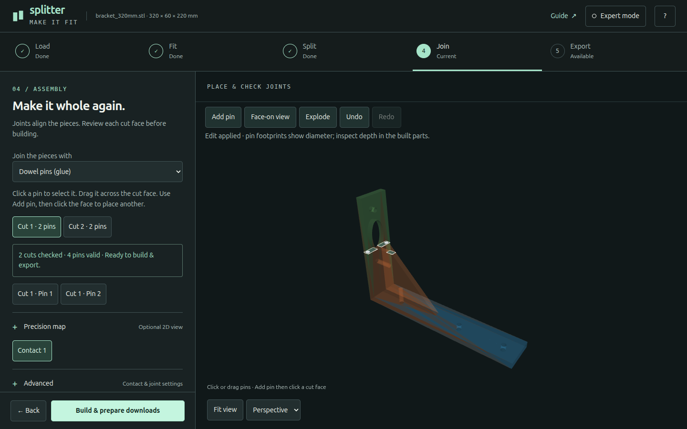

### Desktop expert


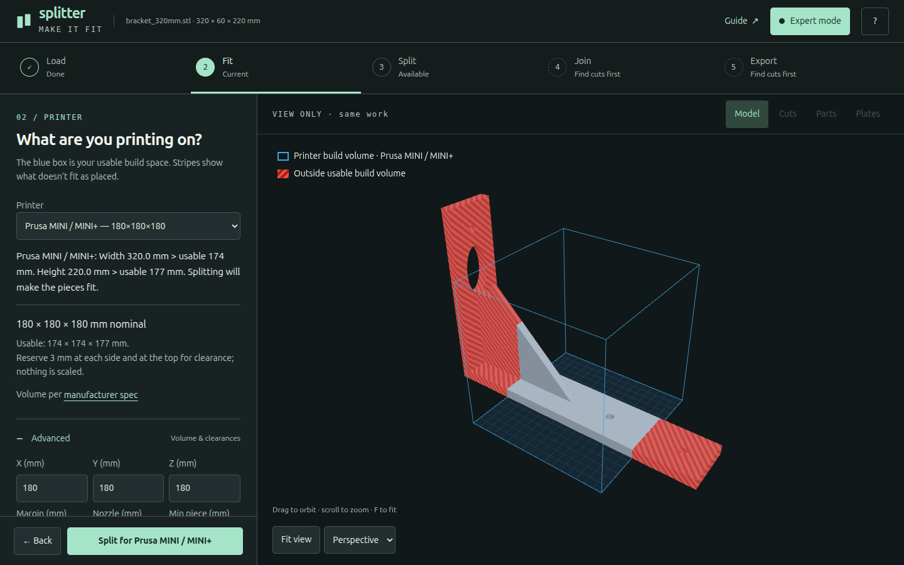

### Phone simple / expert


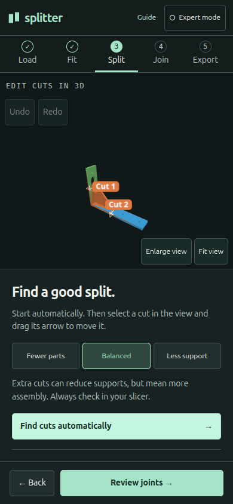


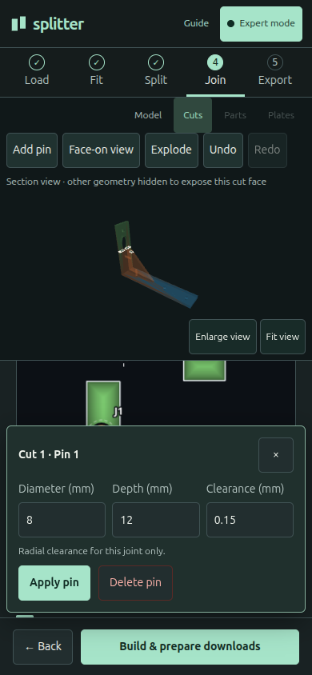

### Loaded state and explicit fit

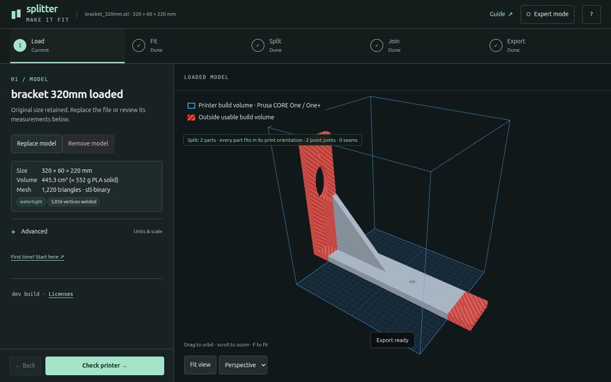

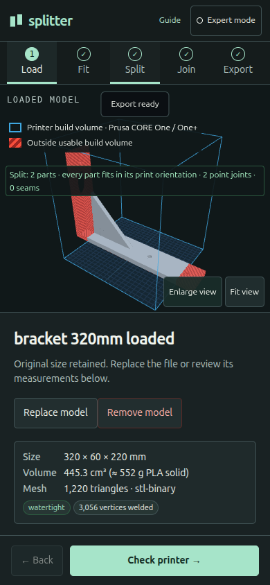


### Actual 3D editing

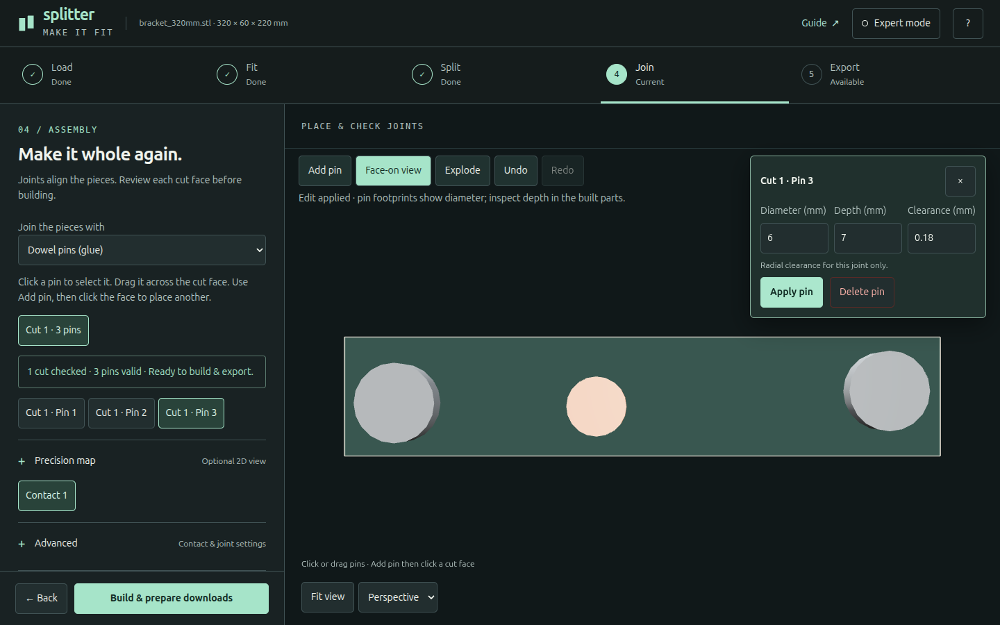

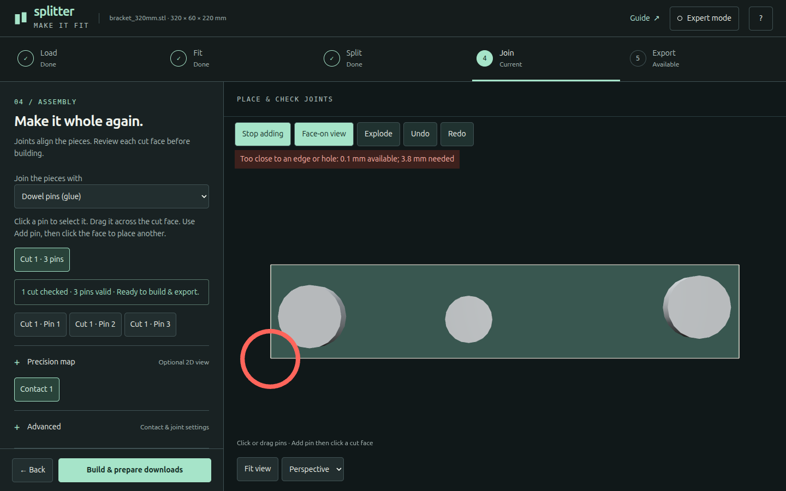

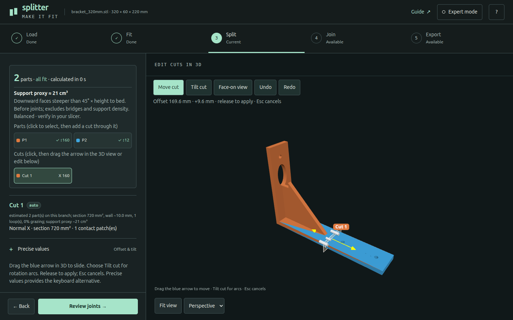

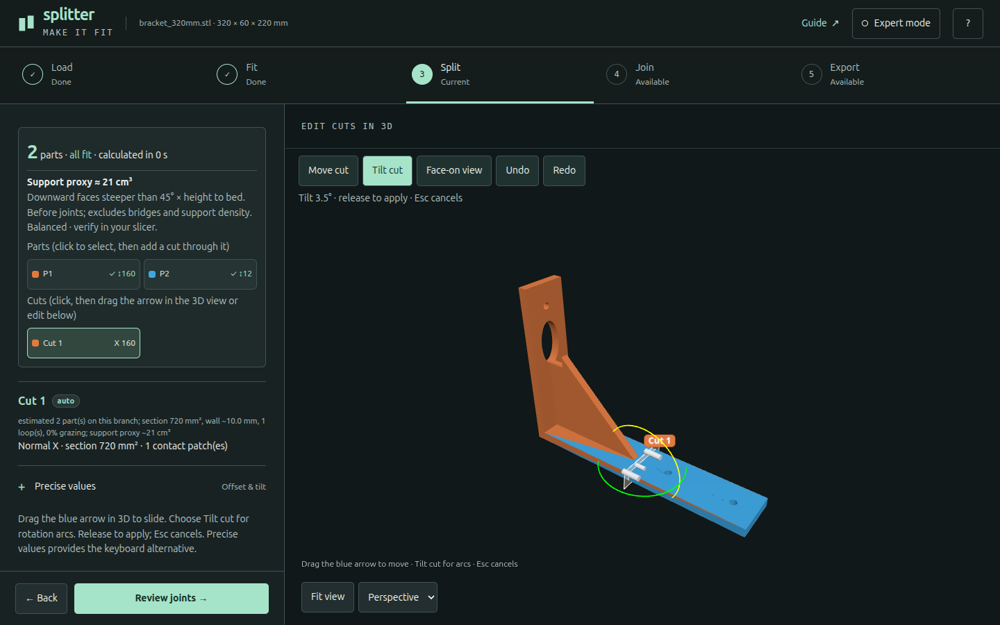

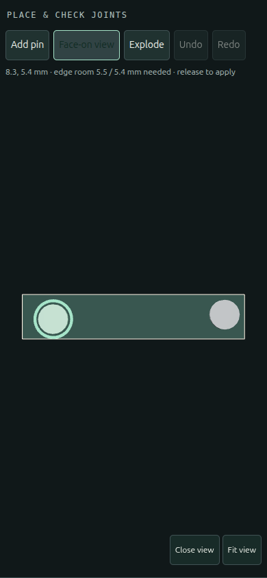

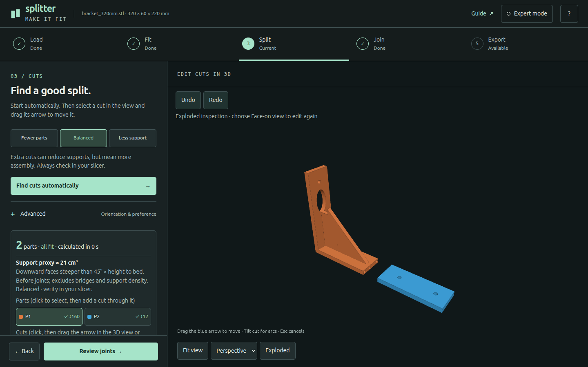

## Honest gaps

1. **Not certified WCAG AA.** Thirty axe states, native alternatives, a complete keyboard path and touch emulation are evidence, not a human screen-reader audit. Complex spatial geometry still needs stronger nonvisual descriptions.
2. **No physical-device or cross-engine claim.** This round used Chromium/software WebGL, including its mobile/touch context. Safari, Firefox, hardware GPU performance and a real phone keyboard were not tested.
3. **Compact phone overview remains a compromise.** Enlarge view is the useful editing space for precise spatial work. The pin inspector is a bottom sheet when not dragging and can cover sidebar context; it hides for the gesture. Arbitrary aspect ratios and extremely dense pin arrangements can still need pan/zoom or the map.
4. **Live checks are planar.** Red edge/hole/overlap feedback precedes submission; depth and full manifold validation happen later. “Ready to build” is not a structural-strength or printed-fit guarantee.
5. **Undo scope is intentionally limited.** It restores accepted cut/joint plans, not uploaded files or printer/style preferences, and is lost on reload. The guide states this explicitly.
6. **Expert retains specialist depth.** Some hardware/seam parameters still require Advanced or the precision editor. All original capabilities remain mapped, but every combination of geometry, joint family and source format was not exhaustively revalidated.
7. **No print proof.** Coupons and exported solids were generated, not physically printed or assembled.

The next review should judge whether the now-fast guided path and contextual 3D editing retain Lane B's clarity without requiring a full CAD workspace.
